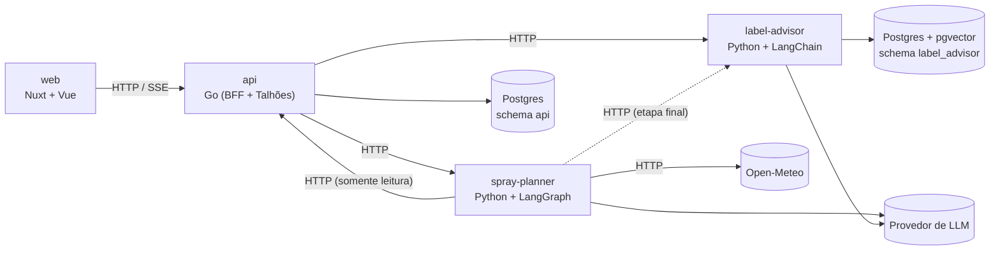
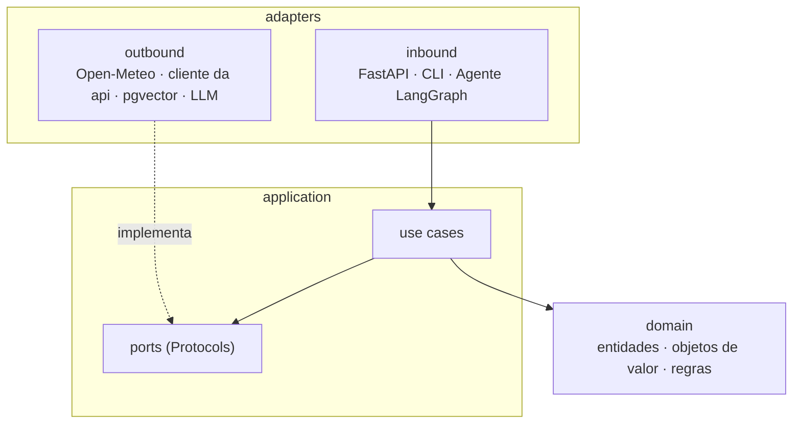

# Agentes Agro

Monorepo de estudo sobre agentes de IA aplicados ao agro, construído com LangChain/LangGraph em Python, uma API em Go e um front-end em Nuxt. O foco é praticar agentes de IA **sem abrir mão de boa arquitetura**: Clean Architecture, SOLID, padrões de projeto e Clean Code em todas as camadas.

> Instruções para o Claude Code e convenções detalhadas estão em [CLAUDE.md](./CLAUDE.md).

---

## Projetos

| Projeto | Serviço | Tipo | Documento |
|---|---|---|---|
| 1. Consultor de Bulas e Boletins Técnicos | `services/label-advisor` | Agente RAG | [docs/projetos/projeto-1-consultor-bulas.md](./docs/projetos/projeto-1-consultor-bulas.md) |
| 2. Planejador de Janela de Pulverização | `services/spray-planner` | Agente com ferramentas | [docs/projetos/projeto-2-planejador-pulverizacao.md](./docs/projetos/projeto-2-planejador-pulverizacao.md) |

**Consultor de Bulas.** Responde perguntas técnicas sobre defensivos (registro, dose, carência, intervalo de reentrada) usando apenas uma base de bulas e boletins técnicos, sempre citando a fonte e recusando quando a resposta não está na base.

**Planejador de Pulverização.** Cruza previsão do tempo, condições de aplicação (Delta T, vento, chuva) e o cadastro de talhões para indicar as melhores janelas de pulverização, com confirmação humana antes de registrar qualquer aplicação.

Na etapa final, o planejador consulta o consultor para verificar a carência antes de sugerir uma janela.

---

## Arquitetura

### Visão geral



### Responsabilidades

| Componente | Linguagem | Responsabilidade | Dono dos dados |
|---|---|---|---|
| `web` | TypeScript (Nuxt/Vue) | Interface de chat com os agentes e gestão de talhões | Nenhum |
| `api` | Go | Porta de entrada única do front (BFF), autenticação, cadastro de talhões e histórico de aplicações, repasse de streaming dos agentes | Talhões e aplicações |
| `spray-planner` | Python | Agente de planejamento de janelas de pulverização | Nenhum (consulta a `api`) |
| `label-advisor` | Python | Ingestão de documentos, busca semântica e agente RAG | Documentos, trechos e embeddings |

Três regras de fronteira:

1. **O front só fala com a `api`.** Os serviços Python nunca ficam expostos diretamente ao navegador.
2. **Cada dado tem um único dono.** O `spray-planner` não acessa o banco de talhões; ele lê pela `api`, por endpoints somente leitura. Isso elimina por construção o risco de dar SQL livre ao agente.
3. **Serviços se comunicam por contrato HTTP versionado**, nunca por banco compartilhado.

### Clean Architecture nos serviços de agente

Os dois serviços Python seguem a mesma organização em camadas, com a regra de dependência apontando sempre para dentro:



| Camada | Contém | Pode depender de |
|---|---|---|
| `domain` | Entidades, objetos de valor e regras de negócio puras (ex.: cálculo de Delta T, regras de aptidão) | Apenas biblioteca padrão |
| `application` | Casos de uso e portas (interfaces) que eles precisam | `domain` |
| `adapters/inbound` | Quem aciona os casos de uso: API FastAPI, CLI e **o próprio agente LangGraph** | `application`, `domain` |
| `adapters/outbound` | Implementações das portas: clima, cliente HTTP da `api`, banco vetorial, LLM | `application`, `domain` |
| `main.py` | Raiz de composição: instancia adaptadores e injeta nos casos de uso | Tudo |

**O ponto central da arquitetura: LangChain é detalhe de infraestrutura.** O agente é um adaptador de entrada, uma interface conversacional sobre os casos de uso, da mesma forma que um endpoint HTTP. Cada ferramenta do agente é fina: valida a entrada, chama um caso de uso e serializa a saída. Toda regra determinística (Delta T, vento, intervalo entre aplicações) vive no domínio e é testada sem LLM nenhum.

### SOLID na prática deste projeto

| Princípio | Onde aparece |
|---|---|
| **SRP** | Um caso de uso por classe (`FindSprayWindows`, `ScheduleApplication`, `IngestDocument`, `AnswerQuestion`) |
| **OCP** | Regras de aptidão como especificações independentes; adicionar uma regra nova não altera as existentes |
| **LSP** | Fakes das portas usados nos testes são intercambiáveis com os adaptadores reais |
| **ISP** | Portas pequenas e específicas (`WeatherProvider`, `FieldReader`, `ApplicationWriter`) em vez de um repositório genérico |
| **DIP** | Casos de uso dependem de portas; a regra de carência começa com uma tabela estática e depois é trocada pelo cliente do `label-advisor` sem tocar no caso de uso |

### Padrões de projeto em uso

| Padrão | Aplicação |
|---|---|
| Ports & Adapters | Fronteira entre aplicação e infraestrutura em todos os serviços |
| Specification | Regras de aptidão (`DeltaTRule`, `WindRule`, `RainRule`) combináveis |
| Strategy | Estratégias de chunking e de extração de PDF intercambiáveis no `label-advisor` |
| Repository | Acesso a talhões e aplicações na `api` |
| Composition Root | Montagem de dependências em um único ponto por serviço |

---

## Estrutura do repositório

```
agentes-agro/
├── README.md
├── CLAUDE.md
├── Makefile                          # atalhos para todos os serviços
├── docker-compose.yml                # Postgres + pgvector e serviços
├── .env.example
│
├── docs/
│   ├── adr/                          # registros de decisão de arquitetura
│   ├── arquitetura/                  # diagramas e contratos entre serviços
│   ├── projetos/
│   │   ├── projeto-1-consultor-bulas.md
│   │   └── projeto-2-planejador-pulverizacao.md
│   └── revisoes/                     # revisão ao fim de cada fase
│
├── services/
│   ├── spray-planner/                # Projeto 2 — Python
│   │   ├── pyproject.toml
│   │   ├── Dockerfile
│   │   ├── src/spray_planner/
│   │   │   ├── domain/
│   │   │   │   ├── entities/         # Field, SprayWindow, WeatherHour
│   │   │   │   ├── value_objects/    # DeltaT, WindSpeed, Coordinates
│   │   │   │   ├── rules/            # especificações de aptidão
│   │   │   │   └── errors.py
│   │   │   ├── application/
│   │   │   │   ├── ports/            # WeatherProvider, FieldReader, ApplicationWriter, ProductRulesProvider
│   │   │   │   ├── use_cases/        # FindSprayWindows, ScheduleApplication
│   │   │   │   └── dto/
│   │   │   ├── adapters/
│   │   │   │   ├── inbound/
│   │   │   │   │   ├── api/          # FastAPI
│   │   │   │   │   ├── cli/
│   │   │   │   │   └── agent/        # grafo LangGraph, tools, prompts/
│   │   │   │   └── outbound/
│   │   │   │       ├── weather/      # Open-Meteo
│   │   │   │       ├── fields/       # cliente HTTP da api (e versão em memória)
│   │   │   │       └── product_rules/# tabela estática → cliente do label-advisor
│   │   │   ├── config.py
│   │   │   └── main.py               # raiz de composição
│   │   ├── tests/
│   │   │   ├── unit/                 # domain e application, sem I/O
│   │   │   └── integration/          # adaptadores
│   │   └── evals/
│   │       ├── datasets/
│   │       └── run_evals.py
│   │
│   ├── label-advisor/                # Projeto 1 — Python
│   │   ├── pyproject.toml
│   │   ├── Dockerfile
│   │   ├── alembic/                  # migrações do schema label_advisor
│   │   ├── data/
│   │   │   ├── raw/                  # PDFs (fora do git)
│   │   │   └── inventory.csv
│   │   ├── src/label_advisor/
│   │   │   ├── domain/               # Document, Chunk, Citation, Answer
│   │   │   ├── application/
│   │   │   │   ├── ports/            # DocumentExtractor, Chunker, Embedder, VectorStore, AnswerGenerator
│   │   │   │   └── use_cases/        # IngestDocument, AnswerQuestion
│   │   │   ├── adapters/
│   │   │   │   ├── inbound/          # api/, cli/ (ingestão), agent/
│   │   │   │   └── outbound/         # extraction/, chunking/, vector_store/, llm/
│   │   │   ├── config.py
│   │   │   └── main.py
│   │   ├── tests/
│   │   └── evals/
│   │
│   └── api/                          # Go
│       ├── go.mod
│       ├── Dockerfile
│       ├── cmd/api/main.go           # raiz de composição
│       ├── internal/
│       │   ├── domain/               # field, application
│       │   ├── usecase/
│       │   ├── adapter/
│       │   │   ├── http/             # handlers, middlewares, DTOs
│       │   │   ├── postgres/         # repositórios (sqlc)
│       │   │   └── agentclient/      # clientes dos serviços de agente
│       │   └── platform/             # config, logger, conexão com banco
│       ├── migrations/
│       └── api/openapi.yaml          # contrato da API
│
├── web/                              # Nuxt + Vue
│   ├── nuxt.config.ts
│   ├── package.json
│   └── app/
│       ├── pages/
│       ├── components/
│       ├── composables/
│       ├── stores/                   # Pinia
│       └── services/                 # única camada que faz chamadas HTTP
│
└── infra/
    ├── docker/
    └── terraform/                    # futuro
```

Não há biblioteca compartilhada entre os serviços Python por enquanto. Duplicação pequena é mais barata que acoplamento prematuro; se um padrão se repetir três vezes, ele vira pacote com ADR próprio.

---

## Stack

| Área | Tecnologias |
|---|---|
| Agentes | Python 3.12+, LangChain 1.x, LangGraph, LangSmith ou Langfuse |
| API dos agentes | FastAPI, Pydantic v2, pydantic-settings, httpx |
| Qualidade Python | uv, ruff, mypy (strict), pytest |
| RAG | Postgres + pgvector, Alembic, extrator de PDF escolhido em ADR |
| API | Go (versão estável atual), `net/http`, pgx, sqlc, golang-migrate, slog, golangci-lint |
| Front-end | Nuxt 4, Vue 3 (Composition API), TypeScript strict, Pinia, Vitest, pnpm |
| Infra | Docker (builds multi-stage), docker-compose; Terraform no futuro |
| Dados externos | Open-Meteo, bulas de fabricantes, AGROFIT, boletins Embrapa |

---

## Como rodar

Pré-requisitos: Docker, uv, Go, Node.js com pnpm e uma chave de API de um provedor de LLM.

```bash
cp .env.example .env        # preencher chaves
make up                     # sobe Postgres e serviços
make dev                    # idem, com hot reload do web
make test                   # testes de todos os serviços
make lint                   # ruff, mypy, golangci-lint, eslint
make eval                   # avaliações dos agentes (usa LLM real, tem custo)
make hooks                  # instala pre-commit e pre-push (qualidade e segurança)
make security               # segredos, SQL injection e CVEs em dependências
cd services/api && go run ./cmd/api   # API em :8080; Swagger UI em /docs, probes em /health/live, /health/startup e /health/ready
```

Cada serviço também roda isolado. Os comandos individuais estão em [CLAUDE.md](./CLAUDE.md).

### Ambiente Docker

O `make up` exige a network externa `inceres-infra`, onde ficam Redis e Kafka. Para que os serviços alcancem o RabbitMQ, conecte-o uma vez com `docker network connect inceres-infra rabbitmq`. As senhas do Postgres vêm do `.env`.

| Serviço | Porta no host (padrão) | Observação |
|---|---|---|
| `agro-api` | 8080 (`API_HOST_PORT`) | Swagger UI em `/docs` |
| `spray-planner` | 8001 (`SPRAY_PLANNER_HOST_PORT`) | Swagger em `/docs` |
| `label-advisor` | 8003 (`LABEL_ADVISOR_HOST_PORT`) | Swagger em `/docs` |
| `agro-web` | 3000 (`WEB_HOST_PORT`) | Front Nuxt |
| `agro-postgres` | 5433 (`POSTGRES_HOST_PORT`) | Postgres 17 + pgvector; bancos `api` e `label_advisor` |

Todos os serviços expõem `/health/live`, `/health/startup` e `/health/ready`. As portas abrem só em `127.0.0.1`. Detalhes em [ADR 0009](docs/adr/0009-docker-compose-e-postgres.md).

---

## Roadmap

A ordem prioriza aprender o agente antes de construir a borda. Os agentes rodam primeiro por CLI; a `api` e o `web` vêm quando há algo útil para expor.

| Semanas | Etapa | Entrega |
|---|---|---|
| 1 a 2 | `spray-planner` — Fases 0 a 2 | Domínio, ferramentas e agente para um talhão, via CLI |
| 3 | `label-advisor` — Fase 0 | Curadoria, inventário e conjunto de avaliação |
| 4 a 7 | `label-advisor` — Fases 1 a 4 | Ingestão, recuperação, resposta com citação, agente |
| 8 a 9 | `spray-planner` — Fases 3 e 4 | Vários talhões (adaptador em memória), regras e aprovação humana |
| 10 a 11 | `api` | Cadastro de talhões, BFF, repasse de streaming; `spray-planner` troca o adaptador em memória pelo cliente HTTP |
| 12 a 13 | `web` | Chat com os agentes e tela de talhões |
| 14 | Integração | `spray-planner` consulta carência no `label-advisor`; fluxo completo no docker-compose |

Se faltar tempo, corte os extras das fases, nunca a avaliação nem os testes do domínio.

---

## Regras de trabalho

1. **Avaliação vem antes do código.** Os conjuntos de avaliação de cada agente são montados na primeira semana.
2. **Decisões arquiteturais viram ADR** em `docs/adr/`, numerados (`0001-titulo.md`), com contexto, opções, decisão e consequências.
3. **Observabilidade desde o primeiro dia.** Todo rastro de agente vai para LangSmith ou Langfuse.
4. **Revisão ao fim de cada fase** em `docs/revisoes/`: o que funcionou, o que travou, decisões tomadas e placar da avaliação.
5. **Commits no padrão Conventional Commits**, com escopo do serviço (ex.: `feat(spray-planner): adiciona regra de vento`).

### ADRs iniciais

| Número | Decisão |
|---|---|
| 0001 | Monorepo com serviços independentes |
| 0002 | Código em inglês, documentação em português, glossário de domínio no CLAUDE.md |
| 0003 | LangChain e LangGraph restritos à camada de adaptadores |
| 0004 | A `api` em Go é dona dos dados de talhões; agentes acessam por HTTP somente leitura |
| 0005 | Postgres com pgvector como banco vetorial |
| 0006 | Extrator de PDF do `label-advisor` (após a comparação da Fase 1) |
| 0007 | Pre-commit para qualidade e segurança (ruff, bandit, gitleaks, golangci-lint, pip-audit, govulncheck) |
| 0008 | API Go com stdlib primeiro; probes de Kubernetes e Swagger embutido |
| 0009 | Docker Compose, Postgres local próximo de produção e esqueletos dos serviços |
