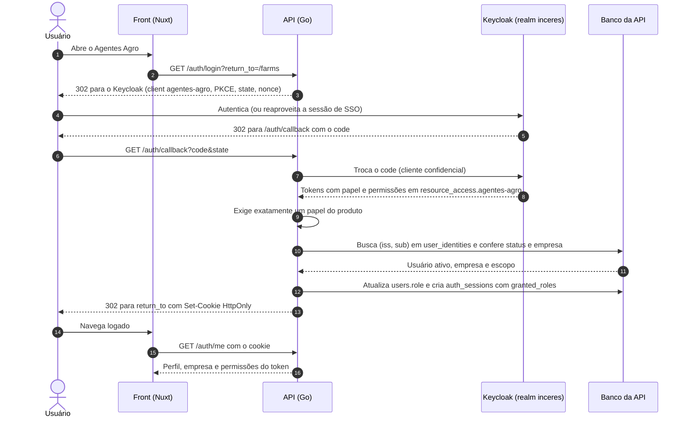
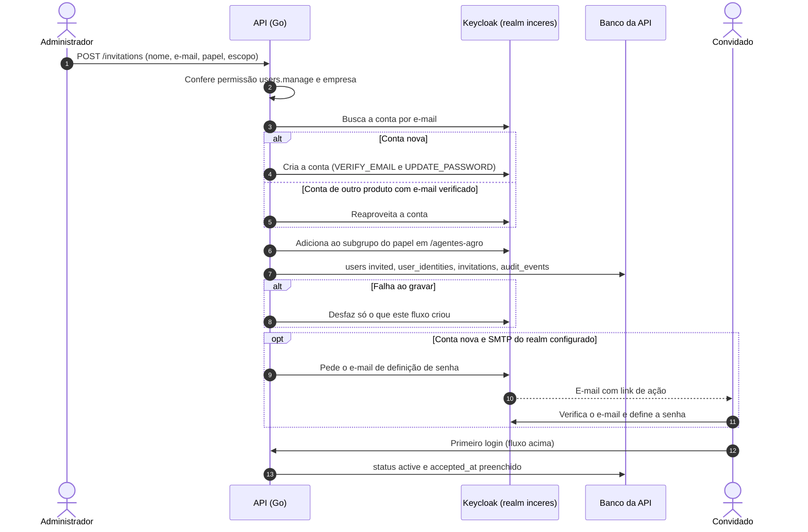

# ADR 0015: Identidade de usuários, SSO Inceres (Keycloak) e vínculo com a empresa

- **Status:** aceito (2026-11-21). **Implementação em andamento:** o Keycloak compartilhado e o banco dedicado dele rodam no projeto `infra-docker` (D1 e D8), e a **parte do produto no realm `inceres` está criada e verificada** (clients `agentes-agro` e `agentes-agro-provisioner`, 8 permissões, 3 papéis compostos e os grupos `/agentes-agro/...`; ver `infra/keycloak/`). Em 2026-11-22 a infraestrutura foi endurecida (revogação de privilégios por grupo e papel, mapper e *client scopes* exatos, baseline de atributos, checagem do realm, auditoria, seed e verificação de tokens; ver o passo 5) sem mudar nenhuma decisão. Em 2026-11-22 o **contrato `openapi.yaml` da Fase A foi concluído** (passo 6; D9). O restante da Fase A (código da API, migrações a partir do DER) ainda não foi iniciado.
- **Data:** 2026-11-21
- **Histórico:** revisão 2 trouxe o realm `inceres` compartilhado e o client `agentes-agro`. A revisão 3 registra as respostas às perguntas: grupos por papel, **permissões no Keycloak**, logout **só do produto**, remoção do login por CPF, **telas inalteradas nesta entrega** e **sem Mailpit**. Aceito em 2026-11-21, com a decisão adicional de que o **Keycloak e o banco dele ficam no projeto `infra-docker`, compartilhados entre os produtos** (não no compose deste repositório).
- **Complementa e ajusta:** ADR 0013 (empresas, papéis e permissões). A **origem do papel e das permissões** passa para o Keycloak (D3); empresa, escopo de fazendas e status no produto continuam da API, que segue aplicando a autorização em cada requisição. Fecha a pendência "fluxo de aceite de convite e definição de senha" do 0013 e o adendo "cookie do token de acesso" do 0010, que pedia ADR próprio.
- **Relacionado:** [DER da API](../arquitetura/der-api.md) (tabelas `users`, `user_identities`, `invitations`, `auth_sessions`).

## Contexto

O contrato atual (`api/openapi.yaml`, tudo `planned`) faz a **própria API** autenticar: `POST /auth/login` recebe e-mail ou CPF e senha e devolve um token; `POST /me/password` troca a senha; convites criam a senha "fora do front". O ADR 0013 decidiu que a API é a única fonte de autorização.

A direção agora é outra e maior: o **Keycloak será o SSO de vários produtos da Inceres**, e o Agentes Agro é o **primeiro produto funcional** sobre ele. Isso muda o problema:

- A identidade (conta, senha, MFA) é **da plataforma**, não do produto. Uma pessoa pode usar mais de um produto com a mesma conta.
- O realm é **compartilhado**. Tudo que o produto cria nele precisa de nome e escopo próprios, e nada que o produto faça pode afetar os outros.
- Papéis, permissões e grupos são geridos no Keycloak, de forma predefinida e versionada.

Começar com autenticação própria para "migrar depois" deixa de fazer sentido: o destino está decidido, e fazer duas vezes dobra o trabalho (hash de senha, redefinição, bloqueio, MFA, migração de hashes, mudança de contrato e do front).

### Requisitos

1. **Uma conta, vários produtos (SSO).** O produto aceita a conta do realm `inceres`, mas só dá acesso a quem foi liberado para ele.
2. Papéis, permissões e grupos do produto são **predefinidos** no Keycloak e versionados.
3. A API continua dona do que é do domínio: empresa (tenant), escopo de fazendas e status no produto. Ela **verifica** as permissões em toda requisição.
4. Credenciais e autenticação ficam fora do código da aplicação.
5. **Desativar alguém no produto não pode desativar a conta nos outros produtos.**
6. Um usuário desativado no produto perde o acesso **imediatamente**.
7. O ambiente local parece com produção (Keycloak real em container).
8. Nenhum bypass de autenticação no código ("modo dev sem login").
9. **Nenhuma tela do front muda nesta entrega**; o front segue no mock (ADR 0010) até uma fase própria, com a sua confirmação.

## Opções

**Eixo 1: onde ficam autenticação, papéis e empresa**

| | Opção | Avaliação |
|---|---|---|
| A | Autenticação própria na API agora, Keycloak depois | Dobra o trabalho, com senhas no nosso banco por um período. Incompatível com o SSO. Rejeitada |
| B0 | Keycloak autentica; papel, empresa e escopo na API (proposta da revisão 1) | Uma fonte só de autorização, mas a atribuição de acesso ficaria fora do SSO. Substituída por decisão de produto |
| **B** | **Keycloak autentica e define papel e permissões (grupos e *client roles*); empresa, escopo e status no produto ficam na API** | Atribuição de acesso centralizada no SSO; o que é do domínio do Agentes Agro fica com a API. **Escolhida** |
| C | Keycloak também com a empresa (*Organizations*) | A empresa é tenant de todas as FKs do banco da API; levá-la para o provedor agora acopla e adianta uma decisão que depende dos outros produtos. Adiada (ver "Evolução") |

**Eixo 2: papéis e permissões no Keycloak**

| | Opção | Avaliação |
|---|---|---|
| R1 | *Realm roles* | Nomes globais ao realm: `admin` de um produto colide com o de outro. Rejeitada |
| R2 | *Client roles* com 3 papéis; permissões derivadas na API | Política de permissões fica no código da API. Era a proposta da revisão 2; **trocada por decisão sua** |
| **R3** | ***Client roles* do client `agentes-agro`: 8 permissões + 3 papéis compostos** | O Keycloak é a fonte de papéis e permissões; o token já traz tudo que a API precisa. Ajustar o que um papel pode fazer é mudança declarativa no realm, sem deploy da API. **Escolhida** |

**Eixo 3: sessão do navegador**

| | Opção | Avaliação |
|---|---|---|
| F1 | Front como cliente público (PKCE), token no navegador | Simples, mas o token fica ao alcance de JavaScript (XSS). Contraria o adendo do ADR 0010 |
| **F2** | **API como cliente OIDC confidencial (padrão BFF), cookie `httpOnly`** | Tokens nunca chegam ao JavaScript. Mais código na API. É o caminho que o ADR 0010 apontava. **Escolhida** |
| F3 | Nuxt/Nitro como BFF | Cria rotas em `server/` (hoje só probes) e o front deixaria de falar só com a API. Rejeitada |

## Decisão

### D1. SSO Inceres: realm `inceres`, client `agentes-agro`

- **Realm `inceres`**, compartilhado entre os produtos. O produto nunca usa o realm `master`.
- **Client `agentes-agro`** (OpenID Connect, **confidencial**, *Authorization Code* com PKCE S256, `redirect_uri` exata, URL de *back-channel logout*). É o "tipo de login" do produto: quem o usa é a `services/api`.
- **Convenção de nomes para qualquer produto no realm** (o Agentes Agro serve de modelo aos próximos):
  - client principal: `<produto>`; outros clients: `<produto>-<função>` (ex.: `agentes-agro-provisioner`);
  - *client roles* ficam no client do produto; grupos ficam sob um grupo raiz `/<produto>`;
  - o produto só cria, altera e remove objetos com o seu prefixo.
- O Keycloak compartilhado da Inceres roda no projeto **`infra-docker`** (`C:\Projetos\Inceres\infra-docker`, arquivo `docker-compose-keycloak.yml`, subido pelo `up.sh` junto de Kafka, Redis e demais), na rede `inceres-infra`, com um **Postgres dedicado** (`db-keycloak`). O realm `inceres` base é importado de `keycloak/import/inceres-realm.json` naquele projeto e traz **só a parte da plataforma** (política de senha, força bruta, sessões, eventos, idioma), sem usuários, senhas nem objetos de produto. Este repositório **não** sobe Keycloak próprio: o produto só aponta para ele por variáveis de ambiente (URL do emissor e credenciais).

### D2. Quem é dono de quê

| Dado | Dono | Observação |
|---|---|---|
| Conta, senha, MFA, política de senha, bloqueio por tentativas, redefinição, SSO, páginas de login | **Keycloak (plataforma)** | A API nunca vê nem guarda |
| `sub` (identificador estável), e-mail e sua verificação | **Keycloak** | A API guarda uma cópia do e-mail para busca e exibição |
| **Papel e permissões do usuário no produto** | **Keycloak** (grupo → papel composto → permissões) | `users.role` na API é **projeção**; as permissões não são gravadas no banco (D3) |
| Empresa do usuário, escopo de fazendas, `primary_farm` | API | Dados do domínio do Agentes Agro |
| Status no produto (`invited`, `active`, `inactive`) | API | Vale só para o produto (D5) |
| Nome de exibição | API | Definido no convite; editado em `PATCH /me/profile` |
| Convite (quem convidou, validade, aceite) | API | O link de ação e o prazo de uso são do Keycloak |
| Configuração do realm (política de senha, SMTP, força bruta, temas globais) | **Plataforma Inceres** | O produto declara requisitos (D8), mas não altera |

### D3. Papéis, permissões e grupos no Keycloak

**No Keycloak (predefinido, versionado, prefixo `agentes-agro`):**

| Item | Nomes | Função |
|---|---|---|
| *Client roles* de **permissão** (8) | `dashboard.view`, `companies.manage`, `users.manage`, `users.manage_all`, `registry.write`, `applications.register`, `applications.confirm`, `planner.use` | Capacidades verificadas pela API e pelo front. Mesmos nomes do `Permission` do contrato |
| *Client roles* de **papel**, compostos (3) | `super_admin`, `admin`, `planning_operator` | Cada um inclui as permissões do perfil |
| Grupo raiz | `/agentes-agro` | Raiz do produto |
| Subgrupos | `/agentes-agro/super-admins`, `/agentes-agro/admins`, `/agentes-agro/planning-operators` | Unidade de atribuição: cada um mapeia **um** papel composto |

Composição dos papéis (a tabela de capacidades do ADR 0013 e do `openapi.yaml`, `Permission`):

| Permissão | `super_admin` | `admin` | `planning_operator` |
|---|---|---|---|
| `dashboard.view` | sim | sim | não |
| `companies.manage` | sim | não | não |
| `users.manage` | sim | sim | não |
| `users.manage_all` | sim | não | não |
| `registry.write` | sim | sim | não |
| `applications.register` | sim | sim | sim |
| `applications.confirm` | sim | sim | não |
| `planner.use` | sim | sim | sim |

- Usuários **entram em grupos**; ninguém recebe papel nem permissão diretamente. Estar em um subgrupo é o que libera o produto.
- O client tem um *mapper* que coloca os *client roles* **efetivos** (incluindo os de papéis compostos) no token (`resource_access.agentes-agro.roles`). A API lê **esse claim**, nunca os grupos.
- **Exatamente um papel do produto por usuário.** Zero: `403 no_access_to_product` (a pessoa tem conta no SSO, mas não neste produto). Mais de um: `403 ambiguous_role` e evento de auditoria. Nunca vale "o mais alto".
- **Permissões** = interseção do claim com o conjunto conhecido de permissões, definido como enum no `domain` da API. Nomes desconhecidos são ignorados. A API **não mantém tabela papel → permissões**: o que o token diz vale.
- **Fonte única da tabela acima:** o `openapi.yaml` a documenta, e o realm versionado a implementa. Um **teste de contrato** no repositório compara os dois e falha se divergirem.
- `GET /auth/me` continua devolvendo `role`, `company`, `farm_scope` e `permissions`, como no ADR 0013; o front continua verificando capacidades, nunca papéis.

**Na API:**

- `users.role` é uma **projeção** do papel, necessária para listar, filtrar e contar usuários (telas Usuários e Empresas) sem consultar o provedor a cada linha. É atualizada no login, a cada renovação do token e pelas operações administrativas da própria API.
- **Permissões da requisição** vêm da última renovação do token, guardada em `auth_sessions.granted_roles` (sessão de navegador) ou do próprio JWT (Bearer). Não há consulta ao Keycloak por requisição.
- **Latência da mudança:** feita pela API (D5), vale na próxima requisição, porque a sessão é marcada para renovar na hora. Feita direto no console do Keycloak, vale na próxima renovação do token (no máximo o tempo de vida do access token, da ordem de minutos). Tokens Bearer valem até expirar.
- **Todo acesso exige usuário `active` no produto, em empresa não `inactive`**, verificado a cada requisição no banco da API. Isso, e não o token, garante o corte imediato.
- **Custo assumido:** mudar a política de permissões é mudança no realm compartilhado (declarativa, com o processo da plataforma), não só deploy da API.

### D4. Vínculo com a identidade externa

Tabela `user_identities (user_id, issuer, subject)`, com `UNIQUE (issuer, subject)` e `UNIQUE (user_id, issuer)` (ver DER).

- A busca é sempre por **`(iss, sub)`**, nunca por e-mail.
- **Sem provisionamento automático no primeiro login (JIT).** Ninguém sabe a **empresa** de quem chega, então o usuário só existe se um administrador o convidou. Token válido sem vínculo recebe `403 user_not_provisioned`. Ter conta no SSO, ou estar em um grupo `/agentes-agro/...` criado à mão no console, não cria usuário no produto.
- **Vínculo por e-mail só pelo provisionamento, nunca no login.** Como o realm é compartilhado, o convidado pode já ter conta de outro produto. O provisionador **reaproveita a conta** (busca por e-mail), exige `email_verified = true`, vincula o `sub` e adiciona o usuário ao grupo. A ação parte de um administrador autorizado e fica em `audit_events`. Se o e-mail não estiver verificado, o provisionador não vincula e reenvia a verificação.
- O modelo suporta outro realm ou provedor: basta uma linha nova em `user_identities`.
- Cada usuário pertence a **uma empresa** (ADR 0013). Se um dia houver mais de uma, `users.company_id` vira tabela de vínculo (DER, pendência 4).

### D5. Provisionamento por porta e o que "desativar" significa em um SSO

Criar, convidar, mudar papel, desativar e remover passa por portas pequenas declaradas em `usecase` (ISP, conforme o CLAUDE.md), por exemplo `IdentityProvisioner`, `InviteSender` e `ProductAccess` (adicionar e remover do grupo, encerrar sessões do produto).

- Adaptador de produção: `adapter/keycloak`, pela **Admin REST API** com `net/http` da biblioteca padrão, autenticado pelo client `agentes-agro-provisioner` (*client credentials*).
- **Requisito do Keycloak 26.8 (verificado):** a Admin API só aceita tokens cuja audiência inclui `…/admin/realms/<realm>`, o que o *client scope* `kc-admin-api` fornece. O client do provisionador o recebe como *scope* padrão; sem ele o token é emitido, mas a API responde `401`. O client usa `fullScopeAllowed` desligado (deprecado no 26.8) e **mapeamento de escopo explícito** para `manage-users` e `view-users`; assim o token só carrega `realm-management` (`manage-users`, `view-users`, `query-users`, `query-groups`), sem as roles `account` do escopo completo.
- Testes usam **fakes** em memória (`tests/fakes/`). Não existe adaptador "local" de senha nem flag que desligue a autenticação.
- **Nome e sobrenome:** o perfil de usuário padrão do Keycloak 26 **exige** `firstName` e `lastName` (sem eles a conta fica "não totalmente configurada" e não obtém token; verificado no `infra-docker`). O provisionador preenche os dois a partir de `users.name`; como a API guarda um nome só, a divisão é só para satisfazer o Keycloak (primeira palavra e o restante, com valor de reserva quando houver uma palavra só).
- **Regras para um realm compartilhado:**
  1. **Desativar no produto nunca desabilita a conta do realm.** Desativar é: `users.status = inactive` no banco (corta o acesso na hora), revogar as `auth_sessions`, **remover o usuário do grupo do produto** e encerrar as sessões do client `agentes-agro`. A conta continua valendo para os outros produtos.
  2. **O provisionador só remove do realm o que ele mesmo criou no mesmo fluxo** (compensação de falha). Nunca apaga conta pré-existente.
  3. **Raio de ação:** o papel `manage-users` do Keycloak vale para o realm inteiro, então a conta de serviço do provisionador **poderia** alterar usuários de outros produtos. Mitigações: operações limitadas pela própria porta (só usuários vinculados em `user_identities` ou criados no fluxo), eventos administrativos ligados e **avaliar as permissões administrativas de granularidade fina (FGAP v2) do Keycloak 26** para restringir o escopo aos grupos `/agentes-agro/...`. A viabilidade exata é verificada na implementação.
- Como são dois sistemas, não há transação única. Ordem, com compensação:
  1. **Convidar:** localiza ou cria a conta no realm; adiciona ao subgrupo do papel; em uma transação no banco grava `users` (`status = invited`), `user_identities`, `invitations` e `audit_events`; **se o banco falhar, desfaz o que criou no Keycloak** (regra 2); por fim pede o e-mail de definição de senha, só quando a conta é nova ou não verificada e o SMTP do realm está configurado. Se o e-mail não sair, o convite continua válido e pode ser reenviado, e a resposta informa isso com honestidade.
  2. **Mudar papel:** move o usuário de subgrupo no Keycloak; em seguida atualiza `users.role`, grava auditoria e **marca as sessões do usuário para renovar o token na próxima requisição** (`auth_sessions.access_expires_at = now()`), o que traz as novas permissões. Se a segunda etapa falhar, a reconciliação corrige a projeção.
  3. **Desativar:** conforme a regra 1. A falha no provedor não deixa brecha, porque o banco já bloqueia.
  4. **Reconciliação:** rotina que compara membros dos subgrupos `/agentes-agro/...`, vínculos e `users.role`. Só **relata** divergências (inclusive quem está em grupo sem ter sido convidado); nunca corrige nem apaga sozinha.
- Provedor fora do ar responde `502 identity_provider_unavailable`, sem registro pela metade.

### D6. Sessão do navegador: a API é o cliente OIDC (BFF)

Fluxo *Authorization Code* com **PKCE (S256)**, `state` e `nonce`, usando o client confidencial `agentes-agro`:

1. O front redireciona para `GET /auth/login?return_to=...`. A API valida o `return_to` (somente caminho relativo, contra *open redirect*) e redireciona ao Keycloak.
2. O usuário se autentica na página do Keycloak. Se já tiver sessão de SSO (por outro produto), **entra sem digitar senha**.
3. `GET /auth/callback`: a API troca o código, valida o ID token e o access token (assinatura, `iss`, `exp`, `nonce`, `aud`/`azp` do client `agentes-agro`), resolve `(iss, sub)` (D4), lê papel e permissões do claim (D3), confere o `status` e cria a sessão.
4. O cookie tem valor **opaco e aleatório**, `HttpOnly; Secure; SameSite=Lax`. No banco ficam só o **hash** dele, os papéis concedidos (`granted_roles`) e o refresh token **cifrado** (AES-256-GCM, chave no ambiente com identificador para rotação). Ver `auth_sessions` no DER.
5. A vida da sessão segue a do Keycloak: a API renova o access token com o refresh token (serializando por sessão, por causa da rotação), **relê papel e permissões do novo token** e, se a renovação falhar ou o papel sumir, encerra a sessão. "Manter conectado" (*remember me* nativo), MFA e revogação feita no Keycloak valem sem código nosso. O *back-channel logout* encerra a sessão pelo `sid`.
6. Escrita exige proteção CSRF: conferência de `Origin` contra a lista do CORS, além do `SameSite`.
7. **Logout só do produto:** `POST /auth/logout` revoga a sessão local e **revoga o refresh token no Keycloak** (endpoint de revogação do OAuth), sem encerrar a sessão de SSO. Os outros produtos continuam logados. Como a sessão de SSO permanece, um novo `GET /auth/login` entraria **sem pedir senha**; por isso o login logo após um "Sair" usa `prompt=login` (reautenticação exigida só para este produto). O *back-channel logout* continua valendo: se o SSO for encerrado pelo realm, a sessão do produto cai.

A API também aceita `Authorization: Bearer` com JWT do realm, validado pela biblioteca de OIDC (assinatura pelas chaves do realm, `iss`, `exp`, audiência do client `agentes-agro`, lista fixa de algoritmos assimétricos). Serve a clientes máquina a máquina (agentes, em ADR futuro) e ao Swagger. O token passa pelas mesmas checagens de D3 e D4.

**Esta decisão é separável.** Se preferir adiar o BFF, aceite as demais e troque a D6 por F1 (cliente público com PKCE); `auth_sessions` deixa de existir e o front guarda o token em memória.

### D7. Convite e primeiro acesso

- **Conta nova:** o convite cria a conta no realm com as ações obrigatórias `VERIFY_EMAIL` e `UPDATE_PASSWORD`. Com SMTP configurado no realm, o e-mail é enviado, e isso resolve a pendência do ADR 0013 **sem página nossa e sem tocar em senha**. O link do e-mail termina em `GET /auth/login` (sem `return_to`, ou seja, para o início da aplicação), registrado como segundo `redirect_uri` exato do client: `/auth/callback` sozinho não tem `code` nem `state` e responderia `422`.
- **Conta já existente no realm** (de outro produto): não há e-mail de senha; o usuário é adicionado ao grupo e, ao entrar, cai direto no produto (D4).
- O primeiro login bem-sucedido de um usuário `invited` (com `email_verified = true` e papel presente) muda `status` para `active`, preenche `invitations.accepted_at` e grava auditoria.
- Reenviar renova `expires_at` e o link; cancelar marca `cancelled_at`, remove o usuário do grupo do produto e some da lista. A conta do realm só é apagada se foi criada por este convite e nunca foi usada (regra 2 da D5).
- O prazo do link é configuração do Keycloak; `invitations.expires_at` o espelha para a tela de Usuários.

### D8. Infraestrutura local e fronteira com a plataforma

**Ambiente local (Keycloak no `infra-docker`, já implementado):**

- **Containers `keycloak` e `db-keycloak`** no projeto `infra-docker`: Keycloak 26.8.2 em modo de desenvolvimento, Postgres 17 **dedicado** (instância separada do `db-sso` e de qualquer banco de produto), sem porta do banco no host. O console escuta só em `127.0.0.1:8180`. Detalhes de uso em `infra-docker/keycloak/README.md`.
- **Endereços:** emissor `http://localhost:8180/realms/inceres`; outros containers da rede `inceres-infra` chamam `http://keycloak:8080`. Este repositório **não** define Keycloak, banco do Keycloak nem Mailpit no seu compose nem no `init/` do seu Postgres.
- **Sem Mailpit e sem SMTP local por padrão.** Em desenvolvimento, os usuários são criados por **script de seed** (senhas lidas do `.env`; **nenhuma senha vai para o repositório**) e entram já com papel, vínculo, `emailVerified: true` e nome completo. O e-mail de convite só funciona se o desenvolvedor configurar um SMTP no realm; sem isso o convite responde, com honestidade, que o e-mail não saiu (D5).
- **Emissor do token (verificado):** o `iss` é **um único valor**, o público. Pelo host, o discovery devolve tudo em `localhost:8180`. Por outro container, o discovery devolve `token_endpoint` e `jwks_uri` em `http://keycloak:8080` e mantém `authorization_endpoint` e `end_session_endpoint` públicos. A API valida o `iss` contra o valor público, busca as chaves e troca o código pela URL interna. Tudo configurável por ambiente, para trocar por outro Keycloak sem mudar código.
- **Primeiro super admin:** comando único e idempotente (`bootstrap`) cria a empresa operadora, o usuário `super_admin`, o vínculo no Keycloak e o grupo `/agentes-agro/super-admins`; em produção, a definição de senha segue o fluxo de convite.

**Fronteira de responsabilidade (vale também em produção):**

| Objeto no realm `inceres` | Dono |
|---|---|
| Client `agentes-agro`, client `agentes-agro-provisioner`, *client roles* (permissões e papéis compostos), grupos `/agentes-agro/...`, *mappers* e *client scopes* do produto, tema de login do client | **Produto (este repositório)**, de forma declarativa e versionada |
| Política de senha, força bruta, SMTP, retenção de eventos, expiração de sessão do realm, temas globais | **Plataforma** |

**Requisitos do produto sobre o realm** (a plataforma precisa garantir): e-mail único e verificado antes de uso, auto-cadastro desligado, política de senha equivalente à do contrato (mínimo de 8, com letras e números), eventos de login e de administração ligados, `sslRequired` em `external` ou mais estrito.

Em produção, aplicar a parte do produto no realm compartilhado deve ser declarativo (por exemplo Terraform com o provedor do Keycloak, em `infra/terraform/`, ou *kcadm*); o local usa a importação do JSON. A escolha da ferramenta e o processo com a plataforma são do ADR de infraestrutura (pendência 1).

### D9. Contrato e front, em duas fases

**Fase A: backend (esta entrega). Nenhuma tela é alterada.** O front segue no mock (ADR 0010), que continua implementando o login atual.

Mudanças em `api/openapi.yaml`:

| Hoje | Fase A |
|---|---|
| `POST /auth/login` (JSON com senha, token na resposta) | Marcado `deprecated` e mantido como `planned`: **nunca será implementado no Go**; existe só para o mock até a Fase B. `identifier` passa a descrever **apenas e-mail** (CPF removido do contrato) |
| (não existia) | `GET /auth/login`, `GET /auth/callback`, `POST /auth/logout` |
| `GET /auth/me` | Igual; aceita cookie de sessão **ou** Bearer; novos `403`: `user_not_provisioned`, `no_access_to_product`, `ambiguous_role` |
| `POST /me/password`, `Profile.password_changed_at` | Marcados `deprecated`, só para o mock; a senha passa a ser trocada no Keycloak |
| `PATCH /me/profile`, `/users`, `/invitations...`, `/companies...` | Iguais; papel e convites passam pelo provisionador |
| `securitySchemes.bearerAuth` | Acrescenta o esquema de cookie de sessão e o de OpenID Connect |
| Tabela de `Permission` | Passa a ser também a **especificação do realm** (teste de contrato, D3) |

- **Login por CPF sai do contrato.** Nenhum campo de usuário guarda CPF (`User` e `UserAccount` não o têm), então o identificador por CPF nunca teve de onde vir. O rótulo "E-mail ou CPF" da tela de login **não é alterado agora**: é texto de tela, tratado na Fase B.
- Enquanto a Fase B não acontece, o front **não consegue** autenticar na API real; ele roda no mock. A integração real do login só nasce com a Fase B, então ela precisa ser planejada logo depois da Fase A.

**Fase B: front (fase própria, exige a sua confirmação, porque altera telas aprovadas).** A tela de login passa a ser a página do Keycloak, com **tema de login próprio do client `agentes-agro`** (o Keycloak permite tema por client, sem afetar outros produtos); "Manter conectado" vira o *remember me* nativo; a troca de senha do Perfil vira redirecionamento; `useAuthToken` e o cookie legível por JavaScript saem; o rótulo do campo de login perde "CPF"; os `deprecated` da Fase A são removidos do contrato e do mock.

## Fluxos

## Segurança

- **Validação de token:** assinatura, `iss`, `aud`/`azp`, `exp` e `nbf` com tolerância pequena de relógio; apenas algoritmos assimétricos; chaves do realm com cache e rotação pela biblioteca; ID token nunca aceito como access token. Em realm compartilhado, **aceitar token de outro client do realm é falha grave**: a checagem de audiência é obrigatória.
- **Permissões vêm do token, então o token é a autoridade:** só se confia em claim de token validado. Os nomes de papel e permissão são os do produto; qualquer outro é ignorado.
- **Cookie de sessão:** valor aleatório de 256 bits, só o hash no banco, `HttpOnly`, `Secure` sempre (navegadores tratam `http://localhost` como contexto seguro, exceto o Safari), `SameSite=Lax`, rotação no login e revogação no logout.
- **Dados sensíveis:** refresh token só cifrado; token, senha e documento nunca em log nem em `audit_events.metadata`.
- **Mínimo privilégio:** `agentes-agro-provisioner` sem acesso a configuração do realm (D5, regra 3); console de administração do Keycloak não exposto publicamente em produção.
- **Auditoria:** convite, reenvio, cancelamento, mudança de papel e escopo, ativação, desativação, vínculo de conta existente e papel ambíguo geram `audit_events`.
- **MFA** para `super_admin` e `admin` é recomendado: no realm compartilhado, é política da plataforma (por exigência de grupo ou de client).
- **LGPD:** a API guarda de usuário apenas nome e e-mail. Nada de CPF, senha ou token em tabela de usuário. Como a conta é compartilhada, o e-mail do convidado pode ser visto por quem opera o realm; avisar no termo de uso.

## Dependências novas

| Dependência | Onde | Justificativa |
|---|---|---|
| `github.com/coreos/go-oidc/v3` | `adapter/oidc` | Validação de JWT e do ID token, descoberta e cache de chaves. Fazer à mão é arriscado e é onde erro vira vulnerabilidade |
| `golang.org/x/oauth2` | `adapter/oidc` | Troca do code com PKCE, renovação e revogação do token e *client credentials* do provisionador |
| `quay.io/keycloak/keycloak` 26.8.2 | `infra-docker` (compartilhado, não é deste repositório) | SSO da Inceres, já implantado com `db-keycloak` (Postgres 17 dedicado) |

Conforme o ADR 0008 ("biblioteca padrão primeiro"), a Admin REST API é chamada com `net/http`, sem SDK. O front **não** ganha dependência: quem fala OIDC é a API.

## Consequências

**Positivas**
- Uma conta para todos os produtos Inceres, e o Agentes Agro já nasce como modelo (nomes, papéis, permissões, grupos, fronteira com a plataforma).
- Nenhuma credencial em código ou banco nossos; não há "migração depois", porque nunca houve autenticação própria.
- Papéis e permissões centralizados e declarativos: ajustar o que um perfil pode fazer não exige deploy da API.
- Desativar no produto não derruba a conta nos outros; a desativação no produto é imediata.
- Tokens fora do alcance de JavaScript (D6); convite com definição de senha pronto e seguro (D7).
- Trocar o Keycloak local pelo compartilhado é configuração.
- Nenhuma tela muda na Fase A.

**Negativas e custos**
- **Duas fontes para o papel** (Keycloak e a projeção `users.role`), com reconciliação e uma janela de defasagem se o papel for mudado direto no console (D3).
- **Política de permissões fora do código da API:** mudança no realm compartilhado, com o processo da plataforma. O produto precisa de um fluxo claro para pedir e aplicar essas mudanças, e o teste de contrato (D3) evita divergência silenciosa.
- **Provisionador com alcance de realm** (D5, regra 3): exige mitigação e verificação do FGAP v2 antes de produção.
- **Acoplamento de login:** se o SSO cai, ninguém entra em nenhum produto. Sessões já abertas continuam enquanto o refresh token for válido.
- **Logout só do produto** deixa a sessão de SSO aberta: sem `prompt=login` no login seguinte, a pessoa voltaria sem senha (D6).
- **Lacuna entre fases:** até a Fase B, o front não usa a autenticação real.
- Mais código de segurança na API (callback, sessão, renovação, CSRF). O Keycloak é mais um serviço Java na máquina de desenvolvimento (cerca de 640 MiB medidos, mais o Postgres dele), mas compartilhado entre os produtos e fora deste compose.
- Sem Mailpit, o fluxo de convite por e-mail não é exercitável localmente sem SMTP próprio; testes usam fakes e o seed cobre o desenvolvimento.
- Em produção, o cookie é do host da API. Para o SSR do Nuxt repassá-lo, web e API devem ficar sob o mesmo host (proxy por caminho) ou sob domínio pai comum, assunto do ADR de deploy.
- **Dependência do `infra-docker`:** o produto só autentica com o Keycloak de pé, e ele vive em outro projeto (que não é um repositório git, então não há histórico nem revisão do que muda ali). A subida é `./up.sh` naquele projeto, e o `db-keycloak` tem volume próprio (`infra-docker_db-keycloak-data`): apagá-lo apaga realm, usuários e sessões de **todos** os produtos.
- Convites dependem de SMTP do realm em produção.

**Evolução**
- **Empresa no Keycloak:** com mais de um produto compartilhando clientes, vale adotar *Organizations* do Keycloak e acrescentar `company_organizations (company_id, issuer, organization_id)`. É migração aditiva, sem mexer em `users`.
- **Agentes:** um client por agente (`agentes-agro-<agente>`, *client credentials*), com a audiência do produto, usando o mesmo validador de Bearer. Registrar em ADR.
- **Grupos por empresa** (`/agentes-agro/empresas/<id>`) se o realm passar a precisar saber a empresa; hoje não é necessário.

## Plano de implementação (só depois do aceite)

De dentro para fora, como pede o CLAUDE.md. **Fase A: backend, sem tocar o front.**

1. `domain`: `User`, `Company`, `Role` e o conjunto conhecido de `Permission`, com testes de tabela; leitura de papel e permissões a partir dos claims.
2. `usecase`: portas (D5) e casos de uso (convidar, reenviar, cancelar, mudar papel, desativar, resolver principal, `GET /auth/me`), com fakes e teste de isolamento entre empresas.
3. Migrações (golang-migrate) e repositórios (pgx + sqlc) conforme o [DER](../arquitetura/der-api.md), com teste de integração em banco descartável.
4. `adapter/oidc` (callback, sessão, Bearer, renovação, revogação, *back-channel logout*) e `adapter/keycloak` (Admin REST).
5. **Parte do produto no realm `inceres`: feito** (`infra/keycloak/`, aplicada com `make keycloak` e verificada de ponta a ponta). Entregue também:
   - **Seed de desenvolvimento** (`make keycloak-seed`): 3 usuários, um por papel, com nome, `emailVerified` e subgrupo; senhas em `KEYCLOAK_SEED_PASSWORD_*` no `.env`; só `localhost`; `--cleanup` remove só o que ele criou.
   - **Verificação** (`make keycloak-verify`): o token de exemplo de cada usuário seed traz exatamente as roles da tabela do `openapi.yaml`, `aud` e `azp` do client, e nenhum `realm_access` nem role de outro client; usuário sem grupo não recebe role do produto.
   - **Endurecimento:** grupos e papéis do produto só podem conter o que o JSON declara (um `realm-admin` acrescentado à mão é revogado); o claim do produto sai de um *mapper* explícito, e os *client scopes* dos dois clients são exatos; atributos de segurança dos clients têm baseline (sem device grant, CIBA, *token exchange* nem PAR); `--check` confere os pré-requisitos do realm (somente leitura) e `make keycloak-audit` lista quem está em cada papel.
   - **Variáveis do `.env.example`:** as do script (`KEYCLOAK_URL`, `KEYCLOAK_REALM`, admin, segredos dos clients, `AGENTES_AGRO_API_URL`, `AGENTES_AGRO_API_INTERNAL_URL`, `AGENTES_AGRO_WEB_URL`, `KEYCLOAK_SEED_PASSWORD_*`). **Falta** definir os nomes que a **API** vai ler (URL do emissor, URL interna, segredos dos clients), junto do `adapter/oidc` (passo 4); este passo não os definiu antes, ao contrário do que o texto anterior afirmava.
6. **Contrato `openapi.yaml` (D9, Fase A): feito** e **teste de contrato entre o `openapi.yaml` e o realm** (já existia, `make keycloak-test`). O mock e as telas **não** mudaram. Entregue no contrato (todos `x-status: planned`):
   - `GET /auth/login` (`return_to` só caminho relativo; `302` ao Keycloak com PKCE S256, `state`, `nonce`; `prompt=login` após logout), `GET /auth/callback` (`302` com cookie `agro_session`; `403` `user_not_provisioned`, `no_access_to_product`, `ambiguous_role`; `502`), `POST /auth/logout` (CSRF por `Origin`) e `POST /auth/backchannel-logout` (cliente: Keycloak; form `logout_token`);
   - `POST /auth/login` e `POST /me/password` `deprecated` (só mock; `identifier` só e-mail; `Profile.password_changed_at` `deprecated`);
   - `GET /auth/me` aceita cookie **ou** Bearer, com os novos `403`; `securitySchemes` com `sessionCookie` (apiKey in cookie `agro_session`), `bearerAuth` e `openIdConnect`; endpoints de negócio aceitam cookie **ou** Bearer;
   - códigos de erro novos no enum de `Error`: `user_not_provisioned`, `no_access_to_product`, `ambiguous_role`, `identity_provider_unavailable`;
   - usuários e convites: formato igual, com `502 identity_provider_unavailable` e o cabeçalho opcional `X-Invitation-Email` (`sent`, `not_sent`, `not_needed`) em `POST /invitations` e no reenvio, para a resposta honesta quando o e-mail não saiu.
7. Comando `bootstrap` e roteiro de produção (aplicação declarativa no realm compartilhado).

**Fase B: front** (fase própria, com a sua confirmação): login pelo Keycloak com tema do client, troca de senha por redirecionamento, remoção de `useAuthToken`, limpeza dos `deprecated`.

## Pendências

Decididas na revisão 3: grupos por papel; permissões como *client roles* no Keycloak; logout só do produto; BFF; remoção do login por CPF; telas inalteradas na Fase A; sem Mailpit.

1. **Operação do Keycloak compartilhado em produção:** em desenvolvimento ele já roda no `infra-docker`, e o produto aplica a sua parte por script sobre a Admin API (`make keycloak`). Falta definir quem opera o realm fora da máquina local, se esse script serve em produção ou se entra Terraform ou *kcadm*, e se o FGAP v2 está disponível para restringir o provisionador aos grupos do produto. Define o ADR de infraestrutura.
2. **Quando fazer a Fase B** (front), já que sem ela o front não autentica na API real.
3. **Rotação de refresh token no realm:** `revokeRefreshToken` está **desligado** no `inceres`. O desenho da sessão (D6) a assume; ligar é decisão da plataforma, porque vale para todos os produtos. O `--check` avisa enquanto estiver desligado.
4. **Pedidos à plataforma** (senha mais forte, retenção de eventos, SMTP, tempos de vida, produção, backup, MFA para administradores, entre outros): reunidos, com valor e motivo, em [`infra/keycloak/PLATFORM-REQUESTS.md`](../../infra/keycloak/PLATFORM-REQUESTS.md). Alguns são decisão do usuário.

## Aceite

Aceito em 2026-11-21, com as respostas registradas na revisão 3 e a decisão de hospedar o Keycloak e o banco dele no projeto `infra-docker`. A Fase A segue o plano acima; a Fase B (front) só começa com a confirmação das telas. O [DER](../arquitetura/der-api.md) passa a ser a base das migrações.

## Fase B: front (implementada em 2026-11-22)

Autorizada pelo usuário, como previsto na D9. O front passa a usar a API real para sessão, usuários, convites, empresas e perfil; o mock continua para dev sem API e para os endpoints ainda `planned` (ADR 0010, adendo de 2026-11-22).

- **Login:** a tela `/login` não tem senha na API real. O botão é um link para `{apiBase}/auth/login?return_to=<rota>` (a rota vem de `?redirect=`, validada por `safeRedirect`; sem ela, `/`). O formulário de e-mail e senha (rótulo agora só "E-mail", sem CPF) existe apenas no mock. "Esqueci minha senha" e "Manter conectado" saem da tela real: ficam na página do Keycloak.
- **Sessão:** cookie `HttpOnly` `agro_session`, invisível ao JavaScript. O cliente HTTP usa `credentials: 'include'`; no SSR repassa o `cookie` da requisição à API (`useRequestHeaders`). `useAuthToken` e o cabeçalho `Authorization` saem do caminho real. O middleware restaura o usuário com `GET /auth/me` (uma vez por carga); um 401 em qualquer chamada de página esquece o usuário e volta ao login com a rota de origem.
- **Erros de acesso:** 401 vai ao login. 403 `user_not_provisioned`, `no_access_to_product`, `ambiguous_role` ou `forbidden` (usuário ou empresa inativos) vai a `/login?error=<código>` com mensagem clara; falha da própria API vai a `?error=unavailable`. `/login` nunca consulta `/auth/me` quando traz `?error=`, e o login só começa por clique, então não há laço.
- **Logout:** `POST /auth/logout` (o navegador envia `Origin`, exigido pela API) e só depois o estado local é limpo; se o servidor recusar, a sessão continua e o erro aparece. O próximo login usa `prompt=login` (a API cuida disso).
- **Senha:** o Perfil não troca mais senha na API real; a seção aponta para a conta do Keycloak (`NUXT_PUBLIC_ACCOUNT_URL`, padrão `<KEYCLOAK_URL>/realms/<realm>/account`). `POST /auth/login` e `POST /me/password` não são chamados.
- **Convites:** o cabeçalho `X-Invitation-Email` (`sent`, `not_sent`, `not_needed`) vira aviso honesto: `not_sent` e cabeçalho ilegível são avisos ("convite criado, mas o e-mail não foi enviado"), nunca sucesso.
- **Cookies entre portas:** `localhost:3000` e `localhost:8002` são o mesmo site (cookies ignoram a porta), então `SameSite=Lax` basta; o CORS da API (`API_CORS_ALLOWED_ORIGINS`, com credenciais) cobre a leitura da resposta. `127.0.0.1` é outro site: abra o front por `localhost`. `Secure` em `http://localhost` funciona no Chrome e no Firefox; o Safari não grava cookie `Secure` em HTTP.

**Lacunas encontradas (pedem ajuste na API, fora do front):**
1. `GET /auth/callback` responde `Location: <return_to>` relativo, que o navegador resolve contra o host da **API**, não do front, quando os dois têm portas ou hosts diferentes. Em produção (mesmo host, ADR acima) funciona; em dev o usuário cai em `localhost:8002/<rota>`. Correção sugerida: a API monta o redirecionamento absoluto com `AGENTES_AGRO_WEB_URL` (já existe no compose e no script do Keycloak).
2. As falhas do callback (403, 422, 502) respondem JSON no host da API: o usuário vê JSON cru. Sugestão: redirecionar para `<web>/login?error=<código>`; a tela já entende `user_not_provisioned`, `no_access_to_product`, `ambiguous_role`, `forbidden` e `identity_provider_unavailable`.
3. `Access-Control-Expose-Headers` lista só `X-Request-Id`: o navegador não lê `X-Invitation-Email` entre origens. O front trata como "não foi possível confirmar o envio". Correção: expor `X-Invitation-Email`.
**Resolvidas na API (lacunas 1 a 3):** o `GET /auth/callback` redireciona para a URL absoluta do front (`AGENTES_AGRO_WEB_URL` + `return_to` validado; sem a variável, segue relativo) e, em falha, para `<web>/login?error=<código>` (`user_not_provisioned`, `no_access_to_product`, `ambiguous_role`, `forbidden`, `identity_provider_unavailable`; login inválido, expirado ou falha interna viram `unavailable`, sem detalhes), sem criar sessão. `X-Invitation-Email` passou a constar em `Access-Control-Expose-Headers`.

4. O tema de login do client `agentes-agro` e a remoção dos `deprecated` (`POST /auth/login`, `POST /me/password`, `password_changed_at`) do contrato seguem pendentes: o mock ainda os usa, então saem junto com `services/mock/`.
