# DER da API (`services/api`)

- **Status:** aceito com o [ADR 0015](../adr/0015-identidade-de-usuarios-e-keycloak.md) (2026-11-21). Tabelas `users`, `user_identities`, `invitations` e `auth_sessions` conforme as decisões D3 a D6 do ADR. **Revisão 2026-11-22:** ajustes de soft delete, FKs e CHECKs na seção 10, já implementados nas migrações `000001` a `000010` (`services/api/migrations/`) para `companies`, `crops`, `farms`, `users`, `user_identities`, `auth_sessions`, `invitations`, `user_farm_access` e `audit_events`. **Adendo 2026-11-23:** `owners` e `farm_owners` implementados nas migrações `000013` e `000014`; `fields`, `municipalities` e `owner_documents` nas `000015` a `000018` (ver adendos da seção 10). Só `applications` continua no desenho.
- **Banco:** `api` (PostgreSQL 17 com PostGIS, ADR 0014). Dono: `services/api`. Nenhum outro serviço acessa estas tabelas.
- **Fase:** pré-requisito da Fase 3 (persistência). Migrações das entidades de usuários e empresas criadas e testadas em banco descartável (`make db-test`).

## 1. Escopo

**Entra:** tudo que a API precisa persistir para cumprir o contrato `api/openapi.yaml` e os ADRs 0013 e 0015: empresas (tenant), usuários e identidade, sessões web, convites, escopo de fazendas, fazendas, talhões, culturas, proprietários, vínculos, documentos, aplicações e trilha de auditoria.

**Fica de fora, de propósito:**

| Item | Motivo |
|---|---|
| Senhas, hashes de senha, fatores de MFA, conta do SSO | Pertencem ao Keycloak, realm `inceres` (ADR 0015). A API nunca guarda credencial |
| Atribuição do papel e das permissões (grupos e *client roles*) | Fonte é o Keycloak; `users.role` é só projeção |
| Banco do Keycloak | Instância Postgres dedicada (`db-keycloak`) no projeto `infra-docker`, compartilhada pelos produtos; nada dele fica neste banco |
| Chunks, embeddings, bulas | Banco `label_advisor` (outro dono) |
| Janelas de pulverização, condição do talhão, alertas do agente | Calculados pelo `spray-planner` a partir de regra de domínio e previsão; não são dado da API |
| Previsão do tempo | Lida da API de clima, nunca persistida |
| Importação de perímetro (`POST /perimeter-imports`) | Operação sem estado: lê o arquivo e devolve geometria, área e centróide |
| Bytes dos documentos de proprietário | Vão para armazenamento de objetos (pendência 2); o banco guarda só metadados |
| Produtos, doses e equipamento da aplicação | Detalhe da Fase 4; ver pendência 1 |

## 2. Convenções

- **Chaves:** `uuid` com `DEFAULT gen_random_uuid()`. Ids saem na API e na URL, então não são sequenciais. O contrato já os trata como `string`.
- **Tenant (ADR 0013):** toda tabela de negócio tem `company_id NOT NULL`. Toda **FK entre tabelas de tenant é composta** `(company_id, id)`, apoiada em `UNIQUE (company_id, id)` na tabela pai. O banco recusa um talhão apontando para fazenda de outra empresa, mesmo com bug na aplicação (verificado em teste).
- **Tipos:** `timestamptz` para instantes; `numeric` para áreas e percentuais; `text` + `CHECK` para conjuntos fechados (sem `ENUM` nativo); geometria em WGS84 (SRID 4326).
- **Exclusão = soft delete:** o produto nunca apaga conta do realm Keycloak (ADR 0015, D5) nem linha de negócio. `companies` vira `status = 'inactive'`; `users` e `farms` ganham `deleted_at`; convite cancelado tem `cancelled_at`; `crops` tem `is_active`. O papel `api_app` não tem `DELETE` nessas tabelas (privilégio, ver seção 7). Índices únicos de e-mail e semelhantes são parciais (`WHERE deleted_at IS NULL`), de modo que remover libera o valor.
- **`updated_at`** é mantido pela aplicação (`SET updated_at = now()` nas consultas de escrita), sem *trigger*: regra de negócio e efeito colateral não ficam no banco.
- **Concorrência:** `version integer` nas tabelas editáveis (`UPDATE ... WHERE id = $1 AND version = $2`; 0 linhas = conflito, resposta `409`).
- **Nomes:** tabelas no plural e `snake_case`; constraints nomeadas `pk_`, `fk_`, `uq_`, `ck_`, `ix_`.
- **Sem regra agronômica no banco:** só invariantes (tipos, faixas físicas, unicidade, vínculo entre linhas). Delta T, vento e chuva continuam no `domain` do `spray-planner`.

## 3. Diagrama

```mermaid
erDiagram
    COMPANIES ||--o{ USERS : "pertencem"
    COMPANIES ||--o{ FARMS : "possui"
    COMPANIES ||--o{ OWNERS : "cadastra"
    COMPANIES ||--o{ AUDIT_EVENTS : "registra"
    USERS ||--o{ USER_IDENTITIES : "autentica por"
    USERS ||--o{ AUTH_SESSIONS : "abre"
    USERS ||--o{ INVITATIONS : "recebe"
    USERS ||--o{ INVITATIONS : "convida"
    USERS ||--o{ USER_FARM_ACCESS : "enxerga"
    FARMS ||--o{ USER_FARM_ACCESS : "liberada em"
    FARMS ||--o{ FIELDS : "divide em"
    FARMS ||--o{ FARM_OWNERS : "tem vinculos"
    OWNERS ||--o{ FARM_OWNERS : "vinculado a"
    OWNERS ||--o{ OWNER_DOCUMENTS : "anexa"
    CROPS ||--o{ FIELDS : "cultivada em"
    FIELDS ||--o{ APPLICATIONS : "recebe"
    USERS ||--o{ APPLICATIONS : "registra e confirma"
    FARMS ||--o{ RAIN_GAUGES : "mede chuva com"
    RAIN_GAUGES ||--o{ RAIN_READINGS : "lido em"
    RAIN_GAUGES ||--o{ RAIN_GAUGE_FIELDS : "atende"
    FIELDS ||--o| RAIN_GAUGE_FIELDS : "usa no maximo um"
    FIELDS ||--o{ SOIL_INSPECTIONS : "vistoriado em"

    COMPANIES {
        uuid id PK
        text name
        text document UK "CNPJ 14 digitos"
        text plan "basic, pro, trial"
        text status "active, trial, inactive"
        boolean is_platform_operator
    }
    USERS {
        uuid id PK
        uuid company_id FK
        text email UK "normalizado, unico entre ativos"
        text role "super_admin, admin, planning_operator"
        text status "invited, active, inactive"
        text farm_scope_mode "all, selected"
        uuid primary_farm_id FK "nulo"
        timestamptz deleted_at "soft delete"
    }
    USER_IDENTITIES {
        uuid id PK
        uuid user_id FK
        text issuer UK
        text subject UK "sub do token"
    }
    AUTH_SESSIONS {
        uuid id PK
        uuid user_id FK
        bytea token_hash UK "sha256 do cookie"
        text idp_session_id "sid do Keycloak"
        bytea refresh_token_enc "cifrado"
        text_array granted_roles "papeis do token"
        timestamptz expires_at
        timestamptz revoked_at
    }
    INVITATIONS {
        uuid id PK
        uuid user_id FK
        uuid invited_by_user_id FK
        timestamptz expires_at
        timestamptz accepted_at
        timestamptz cancelled_at
    }
    USER_FARM_ACCESS {
        uuid user_id PK, FK
        uuid farm_id PK, FK
    }
    FARMS {
        uuid id PK
        uuid company_id FK
        text name
        text status "draft, active"
        geometry perimeter "MultiPolygon 4326"
        geometry forecast_point "Point 4326"
        timestamptz deleted_at "soft delete"
    }
    FIELDS {
        uuid id PK
        uuid company_id FK
        uuid farm_id FK
        text crop_code FK
        text name
        geometry polygon "Polygon 4326"
        numeric area_ha "gerada"
        text soil_texture "sandy, medium, clay (nula)"
    }
    RAIN_GAUGES {
        uuid id PK
        uuid company_id FK
        uuid farm_id FK
        text name "unico por fazenda, sem caixa"
        geometry location "Point 4326 (nula)"
    }
    RAIN_GAUGE_FIELDS {
        uuid field_id PK, FK
        uuid farm_id FK "mesma fazenda do talhao e do pluviometro"
        uuid rain_gauge_id FK
    }
    RAIN_READINGS {
        uuid id PK
        uuid rain_gauge_id FK
        numeric rain_mm "0 a 500"
        timestamptz observed_at "unico por pluviometro"
    }
    SOIL_INSPECTIONS {
        uuid id PK
        uuid field_id FK
        text state "dry, ideal, moist, waterlogged"
        timestamptz inspected_at
    }
    TRAFFICABILITY_THRESHOLDS {
        uuid id PK
        text soil_texture UK
        date effective_from UK
        text source "heuristic, calibrated"
    }
    CROPS {
        text code PK
        text name
    }
    OWNERS {
        uuid id PK
        uuid company_id FK
        text person_type "individual, company"
        text document UK "CPF ou CNPJ"
    }
    FARM_OWNERS {
        uuid farm_id PK, FK
        uuid owner_id PK, FK
        text role "owner, tenant, legal_representative"
        numeric share_percent
    }
    OWNER_DOCUMENTS {
        uuid id PK
        uuid owner_id FK
        text kind
        text storage_key
    }
    APPLICATIONS {
        uuid id PK
        uuid company_id FK
        uuid field_id FK
        text status "registered, confirmed, cancelled"
        timestamptz starts_at
        uuid registered_by_user_id FK
        uuid confirmed_by_user_id FK
    }
    AUDIT_EVENTS {
        bigint id PK
        uuid company_id FK
        text actor_kind "user, agent, system"
        text action
        timestamptz occurred_at
    }
```

O diagrama mostra só chaves e colunas-chave; o detalhe de cada tabela está no dicionário. Nas FKs de tenant, a coluna `company_id` acompanha a chave estrangeira (FK composta).

## 4. Dicionário de dados

`NN` = `NOT NULL`. Colunas `created_at`, `updated_at` (`timestamptz NN DEFAULT now()`) e `version` existem nas tabelas editáveis e não são repetidas abaixo.

### `companies` (tenant)

| Coluna | Tipo | Regra |
|---|---|---|
| `id` | uuid | PK |
| `name` | text NN | não vazio |
| `document` | text NN | CNPJ, 14 dígitos; `UNIQUE` |
| `city`, `state` | text NN, char(2) NN | UF |
| `plan` | text NN | `basic`, `pro`, `trial` |
| `status` | text NN | `active`, `trial`, `inactive`; `trial` exige `trial_ends_at` |
| `trial_ends_at` | timestamptz | fim da avaliação |
| `is_platform_operator` | boolean NN | índice único parcial: **no máximo uma** empresa operadora; o super admin pertence a ela (ADR 0013). `CHECK`: a operadora precisa estar `active` |
| `created_at`, `updated_at`, `version` | timestamptz NN, timestamptz NN, int NN | `version >= 1` |

`CHECK`s: `document ~ '^[0-9]{14}$'`, `state ~ '^[A-Z]{2}$'`, `name` e `city` não vazios. Contagens (`farm_count`, `user_count`) são calculadas, não guardadas. Empresa não é apagada: vira `inactive` e, na exclusão (`DELETE /companies/{id}`), recebe `deleted_at` (exclusão lógica; `CHECK`: excluída exige `inactive` e não pode ser a operadora; o CNPJ **continua reservado**, pois `uq_companies_document` é total). O `api_app` não tem `DELETE`. Listagens excluem excluídas e a operadora (índice parcial `ix_companies_listed`); `LockCompany` é `SELECT ... FOR UPDATE` pela PK. O contrato (`Company`, `CompanyInput`, `CompanyUpdate`) é coberto por inteiro: `name`, `document`, `city`, `state`, `plan`, `status`, `trial_ends_at`, `created_at`.

### `users`

| Coluna | Tipo | Regra |
|---|---|---|
| `id` | uuid | PK; é o identificador do usuário na API |
| `company_id` | uuid NN | FK `companies`; `UNIQUE (company_id, id)` |
| `name` | text NN | dono do nome é a API |
| `email` | text NN | **normalizado pela aplicação** (minúsculas, sem espaços nas pontas); `CHECK email = lower(btrim(email))`, formato básico e no máximo 254 caracteres. Índice único parcial `WHERE deleted_at IS NULL`: e-mail único por produto entre usuários não removidos. Vem do Keycloak e é reconciliado no login |
| `role` | text NN | `super_admin`, `admin`, `planning_operator`. **Projeção** do *client role* do Keycloak (grupo `/agentes-agro/...`), atualizada no login, a cada renovação do token e pelas operações administrativas; serve para listar e filtrar sem consultar o provedor (ADR 0015, D3) |
| `status` | text NN | `invited`, `active`, `inactive`. Vale **só para o produto**: desativar aqui nunca desabilita a conta do realm compartilhado |
| `farm_scope_mode` | text NN | `all` (padrão) ou `selected`; só `planning_operator` pode ser `selected` |
| `primary_farm_id` | uuid | FK composta `(company_id, primary_farm_id)`, `ON DELETE SET NULL (primary_farm_id)` |
| `last_access_at` | timestamptz | atualizado no login (com limite de frequência); é o "último acesso" da tela Usuários |
| `deleted_at` | timestamptz | soft delete (convite cancelado ou usuário removido do produto). `CHECK`: removido exige `status = 'inactive'`. Ao remover, a aplicação revoga as sessões, apaga o vínculo em `user_identities` e remove do grupo do Keycloak; **a conta do realm nunca é apagada** (ADR 0015, D5) |

Mudar o usuário de empresa (só super admin) exige antes apagar `user_farm_access` e `primary_farm_id`: as FKs compostas recusam o contrário. O histórico de `invitations` acompanha por `ON UPDATE CASCADE`.

**Não há** coluna de senha, CPF ou token, e **nenhuma tabela de papéis ou permissões**: o banco guarda o papel apenas como projeção do Keycloak, e as permissões vêm do token (ADR 0015, D3).

### `user_identities` (vínculo com o provedor de identidade)

| Coluna | Tipo | Regra |
|---|---|---|
| `id` | uuid | PK |
| `user_id` | uuid NN | FK `users` |
| `issuer` | text NN | URL do realm (claim `iss`) |
| `subject` | text NN | claim `sub`, estável e imutável |
| `last_login_at` | timestamptz | |

Sem `company_id` de propósito: a busca `(issuer, subject)` acontece no login, antes de a empresa ser conhecida (a empresa vem de `users`). Ao remover o usuário no produto, a aplicação **apaga** o vínculo (o `api_app` tem `DELETE` aqui), para o mesmo `sub` poder ser vinculado de novo em convite futuro. `UNIQUE (issuer, subject)`: uma identidade externa pertence a **um** usuário. `UNIQUE (user_id, issuer)`: um usuário tem uma identidade por provedor. A chave de busca é sempre `(issuer, subject)`, nunca o e-mail.

### `auth_sessions` (sessão do navegador, decisão D6 do ADR 0015)

| Coluna | Tipo | Regra |
|---|---|---|
| `id` | uuid | PK |
| `user_id` | uuid NN | FK `users` |
| `token_hash` | bytea NN | SHA-256 (32 bytes) do valor opaco do cookie; `UNIQUE`. O valor em claro nunca é gravado |
| `issuer`, `idp_session_id` | text NN, text nulo | `iss` e `sid` do Keycloak; permitem encerrar a sessão por *back-channel logout*. `sid` é opcional porque nem todo token o traz; `CHECK` token_hash com 32 bytes |
| `refresh_token_enc`, `enc_key_id` | bytea NN, smallint NN | refresh token cifrado (AES-256-GCM) e identificador da chave, para rotação |
| `granted_roles` | text[] NN | papéis e permissões do produto do **último token renovado** (claim `resource_access.agentes-agro.roles`). É de onde a API tira as permissões da requisição; não há tabela papel → permissões no banco |
| `access_expires_at` | timestamptz NN | quando renovar o access token. A API o zera (`now()`) após mudança de papel ou de escopo do usuário, para a próxima requisição renovar e trazer as permissões novas |
| `expires_at` | timestamptz NN | limite da sessão, ditado pelo Keycloak (vida do refresh token, incluindo "manter conectado") |
| `last_seen_at`, `revoked_at` | timestamptz | `last_seen_at` é atualizado com limite de frequência (configuração) |

A consulta por requisição usa `token_hash` (índice único) e junta `users` na mesma ida ao banco. Linhas expiradas ou revogadas são removidas por rotina. O refresh token é credencial: o papel `api_app` é o único com acesso, e a chave de cifra vem do ambiente, nunca do banco.

### `invitations`

| Coluna | Tipo | Regra |
|---|---|---|
| `id` | uuid | PK |
| `company_id`, `user_id` | uuid NN | FK composta para `users` (`ON UPDATE CASCADE`); o usuário é criado com `status = invited` |
| `invited_by_user_id` | uuid NN | FK **simples** para `users`: quem convida pode ser super admin da empresa operadora, que não é a empresa do convidado |
| `expires_at` | timestamptz NN | espelha o tempo de vida do link de ação do Keycloak (configuração) |
| `last_sent_at`, `send_count` | timestamptz NN, int NN | reenvios |
| `account_created` | boolean NN, padrão `false` | `true` se este convite criou a conta no realm: só nesse caso (e se nunca usada) o cancelamento pode apagá-la (ADR 0015, D5/D7) |
| `accepted_at`, `cancelled_at` | timestamptz | mutuamente exclusivos (`CHECK`). Cancelar também faz soft delete do usuário `invited` |
| `created_at`, `updated_at` | timestamptz NN | |

Índice único parcial: **um convite aberto por usuário** (`accepted_at IS NULL AND cancelled_at IS NULL`). Papel, empresa e escopo ficam no próprio `users`, sem duplicação.

### `user_farm_access` (escopo `selected`)

PK `(user_id, farm_id)`; `company_id` NN com FKs compostas para `users` e `farms` (`ON DELETE CASCADE`), então o banco recusa liberar fazenda de outra empresa. Invariante "`selected` exige ao menos uma linha" é da aplicação (ver seção 5).

### `crops` (catálogo global)

`code` (PK, `^[a-z0-9_]+$`), `name` NN, `is_active` NN, `created_at`. Dado de referência, igual para todas as empresas, carregado por migração idempotente (`000003_seed_crops`, as 6 culturas do seed do front). É a única tabela sem `company_id`. O `api_app` só lê.

### `farms`

| Coluna | Tipo | Regra |
|---|---|---|
| `id`, `company_id` | uuid | PK; FK `companies`; `UNIQUE (company_id, id)` |
| `name` | text NN | |
| `code` | text | apelido curto (ex.: STR-01); unicidade é pendência 3 |
| `cooperative` | text | |
| `production_type` | text NN | `coffee`, `grains`, `livestock`, `mixed` |
| `city`, `state` | text NN, char(2) NN | |
| `status` | text NN | `draft`, `active`. `pending` do contrato é **calculado** (proprietário com documento pendente), nunca gravado |
| `postal_code`, `car_number` | text | CEP com 8 dígitos; número do CAR |
| `forecast_point` | geometry(Point, 4326) | ponto da previsão |
| `perimeter` | geometry(MultiPolygon, 4326) | `ST_IsValid`; a API normaliza Polygon para MultiPolygon |
| `perimeter_area_ha` | numeric(14,4) | **coluna gerada** `ST_Area(perimeter::geography) / 10000`; sem risco de divergir do polígono |
| `deleted_at` | timestamptz | soft delete |

Calculados na leitura: `productive_area_ha` (soma dos talhões), `field_count`, `crops`, `owners`, `spray_outlook` (vem do planner) e o perímetro simplificado da lista (`ST_SimplifyPreserveTopology`).

### `fields` (talhões)

| Coluna | Tipo | Regra |
|---|---|---|
| `id`, `company_id`, `farm_id` | uuid | PK; FK composta `(company_id, farm_id)` → `farms`; `UNIQUE (company_id, id)`; índice único `(company_id, farm_id, id)` (migração `000022`, alvo das FKs que amarram a fazenda) |
| `crop_code` | text NN | FK `crops` |
| `name` | text NN | `UNIQUE (farm_id, name)` |
| `block`, `variety` | text | `block` é texto livre ("Área Norte") |
| `season` | text | formato `2026/27` |
| `planting_date` | date | |
| `row_spacing_m`, `plant_spacing_m` | numeric(6,3) | `> 0` |
| `polygon` | geometry(Polygon, 4326) NN | `ST_IsValid` |
| `area_ha` | numeric(14,4) | **coluna gerada** a partir do polígono |
| `soil_texture` | text | `sandy`, `medium`, `clay` ou nula (ADR 0022; sem textura o estado do solo é `unknown`) |

Calculados na leitura: `plants_per_ha = 10000 / (row_spacing_m × plant_spacing_m)`, `last_application_at` (máximo de `applications.starts_at` confirmadas) e `spray_condition` (planner).

### `owners` (proprietários)

| Coluna | Tipo | Regra |
|---|---|---|
| `id`, `company_id` | uuid | PK; FK `companies`; `UNIQUE (company_id, id)` |
| `person_type` | text NN | `individual`, `company` |
| `name` | text NN | |
| `document` | text NN | só dígitos: 11 (PF) ou 14 (PJ), conforme `person_type`; único por empresa entre os não removidos (`uq_owners_company_document`, parcial `deleted_at IS NULL`). Dígito verificador é regra do `domain` |
| `birth_date` | date | só PF |
| `phone`, `email` | text | telefone com 10 ou 11 dígitos |
| `window_alerts_enabled` | boolean NN | alertas de janela por WhatsApp |
| `deleted_at`, `created_at`, `updated_at`, `version` | | soft delete (`api_app` sem `DELETE`) e concorrência otimista |

Dados pessoais (LGPD): `document`, `birth_date`, `phone`, `email`. Acesso restrito ao papel `app`; nunca em log.

### `farm_owners` (vínculos)

PK `(farm_id, owner_id)`: um vínculo (um papel) por par fazenda/proprietário; FKs compostas para `farms` (`CASCADE`) e `owners` (`RESTRICT`). `role`: `owner`, `tenant`, `legal_representative`. `share_percent numeric(5,2)` maior que 0 e no máximo 100 quando `role = 'owner'`, e **nulo quando `role <> 'owner'`**. A soma por fazenda (≤ 100%; exatamente 100% em fazenda `active`) é regra da aplicação (seção 5). `api_app` mantém `DELETE`: substituir vínculos apaga e regrava.

### `owner_documents`

`id`, `company_id`, `owner_id` (FK composta, `CASCADE`), `kind` (`id_card`, `driver_license`, `articles_of_incorporation`, `other`), `file_name`, `storage_key` (referência ao armazenamento de objetos), `content_type`, `size_bytes > 0`, `uploaded_by_user_id` (FK composta), `uploaded_at`. `has_pending_documents` é calculado a partir desta tabela.

### `applications` (esboço; refinar na Fase 4)

| Coluna | Tipo | Regra |
|---|---|---|
| `id`, `company_id`, `field_id` | uuid | PK; FK composta `(company_id, field_id)` → `fields` |
| `status` | text NN | `registered` → `confirmed` ou `cancelled` |
| `source` | text NN | `user` ou `agent` |
| `operation` | text NN | ex.: "Fungicida" |
| `starts_at`, `ends_at` | timestamptz | `ends_at > starts_at` |
| `area_ha` | numeric(14,4) NN | `> 0`; não exceder a área do talhão é regra da aplicação |
| `registered_by_user_id` | uuid NN | **sempre um humano**: quem registrou ou aprovou a proposta do agente (regra de aprovação humana) |
| `confirmed_by_user_id`, `confirmed_at` | uuid, timestamptz | obrigatórios quando `confirmed` |
| `cancelled_at` | timestamptz | obrigatório quando `cancelled` |
| `idempotency_key` | text | `UNIQUE (company_id, idempotency_key)` parcial: repetir a chamada do agente não duplica |
| `notes` | text | |

Mapeia as capacidades `applications.register` e `applications.confirm`. Alimenta o painel (aplicações no mês, confirmadas na semana, pendências).

### `audit_events` (append-only)

| Coluna | Tipo | Regra |
|---|---|---|
| `id` | bigint identity | PK |
| `company_id` | uuid NN | FK `companies` (empresa afetada) |
| `occurred_at` | timestamptz NN | |
| `actor_kind` | text NN | `user`, `agent`, `system`; `actor_user_id` presente **se e somente se** `user` |
| `actor_user_id` | uuid | FK **simples** para `users`: o ator pode ser de outra empresa (super admin da operadora agindo em uma empresa cliente) |
| `actor_name` | text NN | retrato do nome na hora do evento |
| `action`, `entity_type`, `entity_id` | text NN, text NN, uuid | ex.: `application.registered`, `user.role_changed`, `user.deactivated` |
| `metadata` | jsonb NN | detalhes não sensíveis (nunca senha, token ou documento) |

Alimenta "Atividade recente" do painel e a auditoria de ações administrativas. O papel `api_app` só tem `INSERT` e `SELECT` (`REVOKE UPDATE, DELETE, TRUNCATE` na migração `000010`, verificado em teste). Particionar por mês quando o volume pedir.

### Relevo do talhão (ADR 0021, migrações `000019` a `000021`)

`000019` só verifica `postgis_raster` e o driver GDAL GTiff (do init). Classe de relevo e compatibilidade com o método são derivadas no domínio Go, nunca em SQL.

#### `elevation_sources` (referência global, sem `company_id`)

`tile_key` (text PK, ex.: `S22W047`, `CHECK` de formato), `source`, `version`, `fetched_at`, `block_count > 0`. `api_app`: `SELECT` e `INSERT`.

#### `elevation_blocks` (referência global)

`id` (bigint identity PK), `tile_key` (FK `elevation_sources`, `CASCADE`), `rast` (`raster` NN, ladrilho de 256x256). Índices: GiST em `st_convexhull(rast)` (recorte por polígono) e `(tile_key)`. `api_app`: `SELECT` e `INSERT`.

#### `terrain_runs`

`id`, `company_id`, `farm_id` (FK composta → `farms`), `scope` (`missing`, `all`), `requested_by` (FK simples → `users`, como `audit_events`), `requested_at`, `finished_at` (`>= requested_at`). `UNIQUE (company_id, id)` é o alvo de `field_terrain.run_id`. Sem `DELETE` para `api_app`.

#### `field_terrain` (um por talhão)

| Coluna | Tipo | Regra |
|---|---|---|
| `id`, `company_id`, `farm_id`, `field_id` | uuid | FKs compostas `(company_id, field_id)` → `fields` e `(company_id, farm_id)` → `farms`; `UNIQUE (company_id, field_id)` |
| `status` | text NN | `pending`, `calculating`, `ready`, `failed` |
| `failure_reason` | text | obrigatório quando `failed` |
| `run_id` | uuid | FK composta `(company_id, run_id)` → `terrain_runs` |
| `requested_at`, `calculated_at` | timestamptz | |
| `slope_mean_pct`, `slope_p90_pct`, `slope_max_pct` | numeric(7,3) | `>= 0`; máxima `>=` média e `>=` p90 |
| `elevation_min_m`, `elevation_max_m` | numeric(8,2) | máxima `>=` mínima |
| `position` | text | `hilltop`, `slope`, `lowland` |
| `aspect` | text | oito pontos cardeais ou `flat` |
| `slope_histogram_ha` | numeric[] | exatamente 101 posições (faixas de 1 %, a última `>= 100 %`), sem nulos, `>= 0` |
| `profile` | jsonb | array |
| `elevation_source`, `elevation_version`, `elevation_resolution_m` | text, text, numeric(8,2) | proveniência; resolução `> 0` |

`status = 'ready'` exige `calculated_at`, todas as medidas, histograma, perfil e proveniência. Índices: `(company_id, farm_id)` e `(company_id, run_id)` parcial. `api_app` sem `DELETE`. `farm_id` repete a fazenda do talhão para listar sem junção; manter os dois coerentes é da aplicação.

#### `field_terrain_adjustments` (um por talhão)

`id`, `company_id`, `field_id` (FK composta → `fields`, `UNIQUE (company_id, field_id)`), `origin` (`topographic_survey`, `field_assessment`), `slope_mean_pct` e `slope_max_pct` (numeric(5,2), 0 a 100, máxima `>=` média), `position`, `justification` (não vazia, até 1000 caracteres), `adjusted_by` (FK simples → `users`), `adjusted_at`, `version`. `api_app` mantém `DELETE`: remover o ajuste volta ao valor calculado.

### Chuva, solo e trafegabilidade (ADR 0022, migrações `000022` e `000023`)

O estado do solo e o veredito por método nunca são gravados: o domínio da API os calcula a cada leitura com os dados abaixo, o relevo e o modelo Open-Meteo.

#### `rain_gauges` (pluviômetro da fazenda)

`id`, `company_id`, `farm_id` (FK composta → `farms`), `name` (não vazio, até 100 caracteres; único por fazenda sem diferenciar maiúsculas entre os não removidos: `uq_rain_gauges_farm_name`), `location` (`geometry(Point, 4326)`, opcional, `ST_IsValid`), `deleted_at`, `created_at`, `updated_at`, `version`. `UNIQUE (company_id, id)` é alvo de `rain_readings`; `UNIQUE (company_id, farm_id, id)` é alvo de `rain_gauge_fields`. `api_app` sem `DELETE` (soft delete).

#### `rain_gauge_fields` (vínculo talhão → pluviômetro)

PK em `field_id` (no máximo um pluviômetro por talhão). FKs compostas `(company_id, farm_id, field_id)` → `fields (company_id, farm_id, id)` e `(company_id, farm_id, rain_gauge_id)` → `rain_gauges (company_id, farm_id, id)`: como o `farm_id` é o mesmo nas duas, o banco recusa ligar o talhão a pluviômetro de outra fazenda ou empresa. `linked_at`. Substituir o vínculo apaga e regrava (`api_app` mantém `DELETE`).

#### `rain_readings` (leitura do pluviômetro)

`id`, `company_id`, `rain_gauge_id` (FK composta → `rain_gauges`), `rain_mm` (`numeric(6,2)`, 0 a 500: chuva acumulada desde a leitura anterior), `observed_at`, `recorded_by` (FK simples → `users`, como `terrain_runs.requested_by`), `recorded_at`. `UNIQUE (company_id, rain_gauge_id, observed_at)`, que também atende as somas por janela. "Não está no futuro" é regra do domínio. `api_app` sem `UPDATE`, `DELETE` e `TRUNCATE`.

#### `soil_inspections` (vistoria do solo)

`id`, `company_id`, `farm_id`, `field_id` (FK composta → `fields (company_id, farm_id, id)`), `state` (`dry`, `ideal`, `moist`, `waterlogged`; `unknown` não é vistoria), `inspected_at`, `inspected_by` (FK simples → `users`), `note` (opcional, não vazia, até 500 caracteres), `recorded_at`. A validade (12 h) é configuração da API, não do banco. `api_app` sem `UPDATE`, `DELETE` e `TRUNCATE`.

#### `trafficability_thresholds` (referência global, sem `company_id`, como `crops`)

Uma linha por `soil_texture` e `effective_from` (`UNIQUE`); vale a mais recente com vigência até o dia local. Limites de chuva em 48 h (`rain_48h_dry_mm` < `rain_48h_ideal_mm` < `rain_48h_moist_mm`), de umidade em % da capacidade de campo (`moisture_*_pct`, crescentes), `rain_72h_factor` (`>= 1`), `drying_rate_mm_per_day` (`> 0`), `field_capacity_m3m3` (capacidade de campo de referência, `> 0` e `<= 1`; a Open-Meteo não a fornece) e `source` (`heuristic`, `calibrated`). Semeada pela migração com os valores heurísticos do ADR 0022. `api_app` só lê; calibrar é nova migração.

## 5. Onde cada regra é imposta

| Regra | Onde | Observação |
|---|---|---|
| Isolamento entre empresas | **Banco** (FK composta) e aplicação (filtro por `company_id`) | Teste de isolamento obrigatório |
| E-mail único, identidade externa única, uma empresa operadora, um convite aberto por usuário | **Banco** (índices únicos) | |
| Papel × escopo, `share_percent` só para `owner`, CPF/CNPJ por tipo, período e status de aplicação, auditoria com ator coerente | **Banco** (`CHECK`) | |
| Geometria válida e área consistente | **Banco** (`ST_IsValid`, coluna gerada) | |
| Soma das participações de uma fazenda ≤ 100% | Aplicação, com `SELECT ... FOR UPDATE` na fazenda | Resposta `422`; evita corrida entre dois PUT |
| Escopo `selected` com ao menos uma fazenda | Aplicação (mesma transação) | |
| Talhões de uma fazenda não se sobrepõem | Aplicação (`ST_Overlaps`) | `EXCLUDE ... &&` compara caixas, não geometrias: geraria falso positivo |
| Super admin pertence à empresa operadora | Aplicação | |
| Dígito verificador de CPF/CNPJ | `domain` | |
| Permissões de cada papel | **Keycloak** (client `agentes-agro`: papéis compostos) | A API só lê o claim e ignora nomes desconhecidos. Teste de contrato compara o realm com a tabela `Permission` do `openapi.yaml` |
| Papel do usuário (fonte) | Keycloak (client `agentes-agro`) | Exatamente um papel do produto por usuário, senão `403` |
| Condição de pulverização, janelas, alertas | `spray-planner` | |
| Talhão e pluviômetro do vínculo na mesma fazenda | **Banco** (FKs compostas com `farm_id`) e aplicação | |
| Estado do solo, projeção, veredito por método, validade da vistoria, idade máxima do pluviômetro | `domain` da API (limites em `trafficability_thresholds`, janelas em configuração) | Nada em trigger, view ou função SQL |

## 6. Índices (além de PK e únicos)

| Tabela | Índice | Atende |
|---|---|---|
| `users` | `(company_id, status)` parcial `deleted_at IS NULL`; `(company_id, primary_farm_id)` parcial | tela Usuários, convites pendentes; `ON DELETE SET NULL` da fazenda principal |
| `invitations` | `(company_id)` parcial (abertos); `(company_id, user_id)`; `(invited_by_user_id)` | pendentes por empresa; lado filho das FKs |
| `auth_sessions` | `(user_id)` parcial `revoked_at IS NULL`; `(issuer, idp_session_id)` parcial; `(expires_at)` | sessões ativas do usuário, *back-channel logout*, limpeza |
| `farms` | `(company_id, status)` parcial `deleted_at IS NULL` | lista de fazendas |
| `fields` | `(company_id, farm_id)`; `(crop_code)`; GiST em `polygon` | talhões da fazenda, filtro por cultura, consulta espacial |
| `owners` | `(company_id, name)` parcial `deleted_at IS NULL` | lista de proprietários |
| `farm_owners` | `(company_id, owner_id)` | vínculos do proprietário |
| `user_farm_access` | `(company_id, farm_id)` | quem enxerga a fazenda |
| `owner_documents` | `(company_id, owner_id)` | |
| `applications` | `(company_id, field_id, starts_at DESC)`; `(company_id, status, starts_at DESC)` | última aplicação do talhão, painel |
| `audit_events` | `(company_id, occurred_at DESC)` | atividade recente |
| `elevation_blocks` | GiST em `st_convexhull(rast)`; `(tile_key)` | recorte por polígono; lado filho da FK |
| `terrain_runs` | `(company_id, farm_id, requested_at DESC)`; `(requested_by)` | execuções da fazenda; lado filho da FK |
| `field_terrain` | `(company_id, farm_id)`; `(company_id, run_id)` parcial | relevo da fazenda; andamento da execução |
| `field_terrain_adjustments` | `(adjusted_by)` (o `UNIQUE (company_id, field_id)` cobre o tenant) | lado filho da FK |
| `rain_gauges` | `(company_id, farm_id, lower(name))` único parcial; `UNIQUE (company_id, farm_id, id)` | nome único; pluviômetros da fazenda |
| `rain_gauge_fields` | `(company_id, farm_id, rain_gauge_id)` | talhões de um pluviômetro; lado filho da FK |
| `rain_readings` | `UNIQUE (company_id, rain_gauge_id, observed_at)`; `(recorded_by)` | leituras de um intervalo; lado filho da FK |
| `soil_inspections` | `(company_id, field_id, inspected_at DESC)`; `(company_id, farm_id, field_id)`; `(inspected_by)` | vistoria mais recente; lados filhos das FKs |

FKs compostas já têm índice na chave pai (`UNIQUE (company_id, id)`); o lado filho recebe índice conforme a tabela acima. Busca textual por nome (lista de fazendas e proprietários) começa com `ILIKE`; `pg_trgm` exige ADR (pendência 7).

## 7. Privilégios

- `api_migrator` cria tudo; `api_app` recebe DML por `ALTER DEFAULT PRIVILEGES` (já no init). O init cria os dois papéis, o banco `api`, `CONNECT` só para o `api_app` e o PostGIS; **nada precisou mudar no init** (em volume antigo, sem PostGIS, criar a extensão à mão).
- Cada migração retira do `api_app` o que a tabela não usa (privilégio mínimo): `DELETE` em `companies`, `users`, `farms`, `owners` e `invitations` (soft delete); `INSERT`, `UPDATE` e `DELETE` em `crops` (referência); `UPDATE`, `DELETE` e `TRUNCATE` em `elevation_sources` e `elevation_blocks` (só inserem e leem); `DELETE` em `field_terrain` e `terrain_runs` (`field_terrain_adjustments` mantém `DELETE`); `DELETE` em `rain_gauges` (soft delete); `UPDATE`, `DELETE` e `TRUNCATE` em `rain_readings` e `soil_inspections`; `INSERT`, `UPDATE`, `DELETE` e `TRUNCATE` em `trafficability_thresholds` (referência); `rain_gauge_fields` mantém `DELETE` (vínculo substituível); `UPDATE`, `DELETE` e `TRUNCATE` em `audit_events` (append-only). `user_identities`, `auth_sessions`, `user_farm_access` e `farm_owners` mantêm `DELETE` (vínculo e sessão são efêmeros).
- `api_app` nunca tem DDL nem `BYPASSRLS`. Não há papel de leitura ainda; criar `api_readonly` quando houver relatório.
- Nenhum outro banco (`label_advisor`, `keycloak`) conecta aqui: `CONNECT` revogado de `PUBLIC`.

## 8. Contrato → tabelas

| Endpoint (OpenAPI) | Tabelas |
|---|---|
| `GET /auth/me`, `GET/PATCH /me/profile` | `users`, `user_identities`, `companies`, `user_farm_access` |
| `GET /auth/login`, `GET /auth/callback`, `POST /auth/logout`, `POST /auth/backchannel-logout` (ADR 0015, D6; cookie `agro_session`) | `auth_sessions`, `user_identities`, `users`, `invitations`, `audit_events` |
| `GET/PATCH /users`, `GET /users/summary` | `users`, `invitations`, `companies`, `user_farm_access` |
| `POST /invitations`, `/invitations/{id}/resend`, `DELETE /invitations/{id}` | `invitations`, `users`, `user_identities`, `audit_events` |
| `GET/POST/PATCH /companies`, `GET /companies/summary` | `companies` (+ agregados de `farms`, `users`, `applications`) |
| `GET/POST /farms`, `GET/PUT /farms/{farmId}` | `farms`, `farm_owners`, `owners`, `fields` |
| `GET/POST /farms/{farmId}/fields`, `PUT /farms/{farmId}/fields/{fieldId}` | `fields`, `crops` |
| `GET /crops` | `crops` |
| `GET/POST/PUT /owners...`, `/owners/{id}/links` | `owners`, `owner_documents`, `farm_owners` |
| `GET /dashboard` | `applications`, `audit_events`, `fields` (+ janelas e alertas do planner) |
| `POST /perimeter-imports` | nenhuma (sem estado) |
| `GET/POST /farms/{farmId}/rain-gauges`, `PATCH .../rain-gauges/{gaugeId}` | `rain_gauges`, `audit_events` |
| `GET/POST .../rain-gauges/{gaugeId}/readings` | `rain_readings`, `users`, `audit_events` |
| `POST /farms/{farmId}/fields/{fieldId}/soil-inspections` | `soil_inspections`, `audit_events` |
| `GET/PUT /farms/{farmId}/fields/{fieldId}/soil-profile` | `fields.soil_texture`, `rain_gauge_fields`, `rain_gauges`, `audit_events` |
| `GET /farms/{farmId}/fields/{fieldId}/trafficability` | `fields`, `rain_gauge_fields`, `rain_gauges`, `rain_readings`, `soil_inspections`, `trafficability_thresholds`, `field_terrain`, `field_terrain_adjustments` (+ Open-Meteo) |

`POST /auth/login` (JSON com senha) e `POST /me/password` ficam `deprecated` na Fase A do ADR 0015 (só o mock do front os usa) e saem do contrato na Fase B.

## 9. Pendências

1. **Aplicação (Fase 4):** produtos, dose com unidade, equipamento e capacidade operacional. A tabela `applications` acima é o mínimo para o painel e para as permissões; os detalhes entram com o fluxo de aprovação do agente.
2. ~~**Armazenamento dos documentos de proprietário**~~: resolvido pelo ADR 0020 (Amazon S3, migração `000018`).
3. **Unicidade de `farms.code`** por empresa: não consta no contrato; confirmar antes de impor.
4. **Usuário em mais de uma empresa:** ADR 0013 diz que hoje não. Se mudar, `users.company_id` vira tabela de vínculo (`memberships`).
5. **`fields.block` como texto** ou como entidade própria (`field_blocks`), se blocos ganharem atributos.
6. **Chave `uuid` v4 ou v7:** v7 melhora localidade de índice, mas o PostgreSQL 17 não o gera nativamente (precisaria gerar na aplicação).
7. **`pg_trgm`** para busca por nome com índice: o `unaccent` entrou pelo ADR 0017 (sem índice); `pg_trgm` depende de outro ADR quando o volume pedir.
8. **Relevo do talhão (ADR 0021):** implementado nas migrações `000019` a `000021` (`postgis_raster` verificado, `elevation_sources`, `elevation_blocks`, `terrain_runs`, `field_terrain`, `field_terrain_adjustments`; dicionário na seção 4). Contrato e API HTTP implementados (5 operações da tag `Terrain`, 2026-11-24). A classe de relevo e a compatibilidade dos métodos são derivadas no domínio da API, nunca em SQL. Em aberto: o `farm_id` de `field_terrain` não é amarrado por FK ao `farm_id` do talhão; o índice `UNIQUE (company_id, farm_id, id)` em `fields` já existe (migração `000022`), e amarrar `field_terrain` a ele seria uma migração nova.
9. **Chuva, solo e trafegabilidade (ADR 0022, fase 2):** migrações `000022` (índice único em `fields`, `CONCURRENTLY`, sozinho no arquivo) e `000023` (`fields.soil_texture`, `rain_gauges`, `rain_gauge_fields`, `rain_readings`, `soil_inspections`, `trafficability_thresholds`). Em aberto: histórico de estados calculados (`soil_state_history`, fase 4) e calibração dos limites (nova linha com `source = 'calibrated'`).

## 10. Mudanças desta revisão (2026-11-22)

Cada ajuste em relação ao desenho anterior, com o motivo. Verificados por `make db-test`.

| # | Ajuste | Por quê |
|---|---|---|
| 1 | Soft delete: `users.deleted_at` e `farms.deleted_at`; `companies` só `inactive`; `api_app` sem `DELETE` nelas | Decisão do usuário e regra D5 do ADR 0015: remover no produto nunca apaga conta do realm nem história |
| 2 | `users.email` normalizado por `CHECK` (`= lower(btrim(email))`) com índice único parcial simples, no lugar de índice sobre `lower(email)` | O banco recusa e-mail fora do padrão em vez de confiar na aplicação; índice simples serve a busca `email = $1` e o parcial libera o e-mail após remover |
| 3 | `CHECK`: removido exige `status = 'inactive'` | Impede estado incoerente (removido mas "ativo") |
| 4 | `invitations.invited_by_user_id` e `audit_events.actor_user_id` passam a FK **simples** (antes: composta) | O desenho anterior quebrava o caso principal: super admin da operadora convida para outra empresa, e a FK composta exigiria o mesmo `company_id` |
| 5 | `invitations (company_id, user_id)` com `ON UPDATE CASCADE` | Sem isso, todo usuário convidado ficaria impedido de mudar de empresa (a linha do convite aceito o travaria) |
| 6 | `user_farm_access` e `primary_farm_id`: mudança de empresa do usuário só depois de limpá-los (sem `CASCADE` de update) | O banco força a limpeza explícita, em vez de mover acessos para fazendas de outra empresa |
| 7 | `CHECK` da operadora ativa (`is_platform_operator` implica `active`) | Desativar a operadora trancaria todos os super admins |
| 8 | `user_identities` e `auth_sessions` sem `company_id` | São resolvidas por `(issuer, subject)` e `token_hash` antes de a empresa ser conhecida; a empresa vem de `users` na mesma consulta |
| 9 | `idp_session_id` anulável | Nem todo token traz `sid` |
| 10 | `updated_at` mantido pela aplicação; `crops` com seed por migração | Sem *trigger* (regra do CLAUDE.md); culturas iguais às do seed do front |
| 11 | Privilégio mínimo por tabela (seção 7) e `audit_events` append-only por `REVOKE` | Defesa em profundidade além da aplicação |
| 12 | `farms` com `CHECK`s de domínio (tipo de produção, UF, CEP, perímetro válido) | Invariantes, não política agronômica |

**Pendências deixadas:** as regras "super admin pertence à operadora" e "`selected` exige ao menos uma fazenda" seguem na aplicação (seção 5). `farms.code` único por empresa depende da pendência 3. `user_farm_access` de fazenda removida (soft delete) permanece até a aplicação limpá-lo.

### Adendo (migrações 000011 e 000012)

| # | Ajuste | Por quê |
|---|---|---|
| 13 | `invitations.account_created boolean NOT NULL DEFAULT false` | Regra "só apaga a conta do realm criada por este convite e nunca usada"; `ADD COLUMN` com padrão constante não reescreve a tabela |
| 14 | `companies.deleted_at` com `ck_companies_deleted` (excluída exige `inactive` e não operadora), criado `NOT VALID` e validado; `ix_companies_listed` parcial (`deleted_at IS NULL AND NOT is_platform_operator`) | Exclusão lógica do contrato; CNPJ segue único também para excluídas (índice único total); operadora nunca é listada nem excluída |
| 15 | Confirmações: `version` já existia em `users` e `companies` (`>= 1`); e-mail único é parcial (ignora removidos); `UNIQUE (issuer, subject)` é total, mas o vínculo é **apagado** na remoção do usuário, então na prática não prende linhas excluídas | Concorrência otimista e reuso de e-mail/identidade |

### Adendo (migrações 000013 e 000014, 2026-11-23)

| # | Ajuste | Por quê |
|---|---|---|
| 16 | `owners` como no dicionário, com `deleted_at` e `version`; documento único por empresa em índice **parcial** (`deleted_at IS NULL`) | Segue a convenção de soft delete (seção 2): remover libera o documento; o mesmo CPF/CNPJ pode existir em outra empresa |
| 17 | `farm_owners` com PK `(farm_id, owner_id)` em vez de `(farm_id, owner_id, role)` | O contrato, o domínio e as telas tratam um papel por par fazenda/proprietário; a PK mais estreita impõe isso no banco |
| 18 | `share_percent > 0` para o papel `owner` (antes: entre 0 e 100) | Participação zero não é participação; `CHECK` com `IS NOT NULL` explícito, porque `CHECK` que avalia para `NULL` passa |
| 19 | Participação trafega em centésimos de ponto percentual (inteiro) entre domínio e banco | A regra "soma exatamente 100%" sem erro de ponto flutuante |

### Adendo (migrações 000015 a 000018, 2026-11-23)

| # | Ajuste | Por quê |
|---|---|---|
| 20 | `fields` como no dicionário, mais `deleted_at`, `version` e `ck_fields_area` (`area_ha > 0`); nome único por fazenda em índice parcial | Soft delete como o resto do cadastro; todo talhão tem área própria em hectares |
| 21 | Talhão dentro do perímetro, sem sobreposição, com área mínima e fazenda com área mínima: regras da aplicação (`domain.AreaRules`), com tolerância de desenho configurável | `EXCLUDE ... &&` compara caixas; a tolerância evita recusar bordas que o mapa desenha quase coladas |
| 22 | Migração `000016` só verifica a extensão `unaccent` (ADR 0017) | Extensão é do init (superusuário); a migração falha com mensagem clara sem ela |
| 23 | `municipalities` (referência global, sem `company_id`; `api_app` só lê), carregada pelo comando `cmd/load-municipalities` com o `api_migrator` (ADR 0019) | Dado de referência grande demais para uma migração |
| 24 | `owners.documents_pending` (`DEFAULT true`, sem reescrita) e `owner_documents` com `storage_key` amarrada por `CHECK` ao prefixo do proprietário (ADR 0020) | A regra de qual documento é obrigatório fica no domínio; o banco guarda o resultado para filtrar fazendas pendentes |

### Adendo (migrações 000022 e 000023, 2026-11-26)

| # | Ajuste | Por quê |
|---|---|---|
| 25 | Índice único `(company_id, farm_id, id)` em `fields`, criado com `CONCURRENTLY` em migração própria | Alvo das FKs compostas que amarram vínculo e vistoria à fazenda do talhão sem bloquear escrita em `fields` |
| 26 | `fields.soil_texture` nula, com `CHECK` adicionado `NOT VALID` e validado em seguida | Sem reescrita da tabela nem lock exclusivo durante a varredura |
| 27 | `rain_gauges`, `rain_gauge_fields`, `rain_readings`, `soil_inspections` com `company_id NOT NULL` e índices que começam por `company_id` | Tenant no schema (ADR 0013) |
| 28 | `trafficability_thresholds` global e semeada como heurística; vale a linha mais recente com vigência até hoje | Limites são configuração versionada, calibrável sem mudar código (ADR 0022, decisão 2) |
