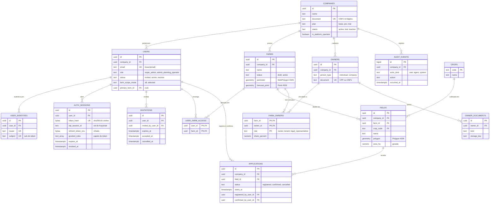

# DER da API (`services/api`)

- **Status:** aceito com o [ADR 0015](../adr/0015-identidade-de-usuarios-e-keycloak.md) (2026-11-21). Tabelas `users`, `user_identities`, `invitations` e `auth_sessions` conforme as decisões D3 a D6 do ADR. Nenhuma migração foi criada ainda.
- **Banco:** `api` (PostgreSQL 17 com PostGIS, ADR 0014). Dono: `services/api`. Nenhum outro serviço acessa estas tabelas.
- **Fase:** pré-requisito da Fase 3 (persistência). Nenhuma migração foi criada ainda.

## 1. Escopo

**Entra:** tudo que a API precisa persistir para cumprir o contrato `api/openapi.yaml` e os ADRs 0013 e 0015: empresas (tenant), usuários e identidade, sessões web, convites, escopo de fazendas, fazendas, talhões, culturas, proprietários, vínculos, documentos, aplicações e trilha de auditoria.

**Fica de fora, de propósito:**

| Item | Motivo |
|---|---|
| Senhas, hashes de senha, fatores de MFA, conta do SSO | Pertencem ao Keycloak, realm `inceres` (ADR 0015). A API nunca guarda credencial |
| Atribuição do papel e das permissões (grupos e *client roles*) | Fonte é o Keycloak; `users.role` é só projeção |
| Banco do Keycloak | Instância Postgres dedicada (`db-keycloak`) no projeto `infra-docker`, compartilhada pelos produtos; nada dele fica neste banco |
| Chunks, embeddings, bulas | Banco `label_advisor` (outro dono) |
| Janelas de pulverização, condição do talhão, alertas do agente | Calculados pelo `spray-planner` a partir de regra de domínio e previsão; não são dado da API |
| Previsão do tempo | Lida da API de clima, nunca persistida |
| Importação de perímetro (`POST /perimeter-imports`) | Operação sem estado: lê o arquivo e devolve geometria, área e centróide |
| Bytes dos documentos de proprietário | Vão para armazenamento de objetos (pendência 2); o banco guarda só metadados |
| Produtos, doses e equipamento da aplicação | Detalhe da Fase 4; ver pendência 1 |

## 2. Convenções

- **Chaves:** `uuid` com `DEFAULT gen_random_uuid()`. Ids saem na API e na URL, então não são sequenciais. O contrato já os trata como `string`.
- **Tenant (ADR 0013):** toda tabela de negócio tem `company_id NOT NULL`. Toda **FK entre tabelas de tenant é composta** `(company_id, id)`, apoiada em `UNIQUE (company_id, id)` na tabela pai. O banco recusa um talhão apontando para fazenda de outra empresa, mesmo com bug na aplicação (verificado em teste).
- **Tipos:** `timestamptz` para instantes; `numeric` para áreas e percentuais; `text` + `CHECK` para conjuntos fechados (sem `ENUM` nativo); geometria em WGS84 (SRID 4326).
- **Concorrência:** `version integer` nas tabelas editáveis (`UPDATE ... WHERE id = $1 AND version = $2`; 0 linhas = conflito, resposta `409`).
- **Nomes:** tabelas no plural e `snake_case`; constraints nomeadas `pk_`, `fk_`, `uq_`, `ck_`, `ix_`.
- **Sem regra agronômica no banco:** só invariantes (tipos, faixas físicas, unicidade, vínculo entre linhas). Delta T, vento e chuva continuam no `domain` do `spray-planner`.

## 3. Diagrama

O diagrama mostra só chaves e colunas-chave; o detalhe de cada tabela está no dicionário. Nas FKs de tenant, a coluna `company_id` acompanha a chave estrangeira (FK composta).

## 4. Dicionário de dados

`NN` = `NOT NULL`. Colunas `created_at`, `updated_at` (`timestamptz NN DEFAULT now()`) e `version` existem nas tabelas editáveis e não são repetidas abaixo.

### `companies` (tenant)

| Coluna | Tipo | Regra |
|---|---|---|
| `id` | uuid | PK |
| `name` | text NN | não vazio |
| `document` | text NN | CNPJ, 14 dígitos; `UNIQUE` |
| `city`, `state` | text NN, char(2) NN | UF |
| `plan` | text NN | `basic`, `pro`, `trial` |
| `status` | text NN | `active`, `trial`, `inactive`; `trial` exige `trial_ends_at` |
| `trial_ends_at` | timestamptz | fim da avaliação |
| `is_platform_operator` | boolean NN | índice único parcial: **no máximo uma** empresa operadora; o super admin pertence a ela (ADR 0013) |

Contagens (`farm_count`, `user_count`) são calculadas, não guardadas. Empresa não é apagada: vira `inactive`.

### `users`

| Coluna | Tipo | Regra |
|---|---|---|
| `id` | uuid | PK; é o identificador do usuário na API |
| `company_id` | uuid NN | FK `companies`; `UNIQUE (company_id, id)` |
| `name` | text NN | dono do nome é a API |
| `email` | text NN | índice único em `lower(email)`; vem do Keycloak e é reconciliado no login |
| `role` | text NN | `super_admin`, `admin`, `planning_operator`. **Projeção** do *client role* do Keycloak (grupo `/agentes-agro/...`), atualizada no login, a cada renovação do token e pelas operações administrativas; serve para listar e filtrar sem consultar o provedor (ADR 0015, D3) |
| `status` | text NN | `invited`, `active`, `inactive`. Vale **só para o produto**: desativar aqui nunca desabilita a conta do realm compartilhado |
| `farm_scope_mode` | text NN | `all` (padrão) ou `selected`; só `planning_operator` pode ser `selected` |
| `primary_farm_id` | uuid | FK composta `(company_id, primary_farm_id)`, `ON DELETE SET NULL (primary_farm_id)` |
| `last_access_at` | timestamptz | atualizado no login (com limite de frequência) |

**Não há** coluna de senha, CPF ou token, e **nenhuma tabela de papéis ou permissões**: o banco guarda o papel apenas como projeção do Keycloak, e as permissões vêm do token (ADR 0015, D3).

### `user_identities` (vínculo com o provedor de identidade)

| Coluna | Tipo | Regra |
|---|---|---|
| `id` | uuid | PK |
| `user_id` | uuid NN | FK `users` |
| `issuer` | text NN | URL do realm (claim `iss`) |
| `subject` | text NN | claim `sub`, estável e imutável |
| `last_login_at` | timestamptz | |

`UNIQUE (issuer, subject)`: uma identidade externa pertence a **um** usuário. `UNIQUE (user_id, issuer)`: um usuário tem uma identidade por provedor. A chave de busca é sempre `(issuer, subject)`, nunca o e-mail.

### `auth_sessions` (sessão do navegador, decisão D6 do ADR 0015)

| Coluna | Tipo | Regra |
|---|---|---|
| `id` | uuid | PK |
| `user_id` | uuid NN | FK `users` |
| `token_hash` | bytea NN | SHA-256 (32 bytes) do valor opaco do cookie; `UNIQUE`. O valor em claro nunca é gravado |
| `issuer`, `idp_session_id` | text NN, text | `iss` e `sid` do Keycloak; permitem encerrar a sessão por *back-channel logout* |
| `refresh_token_enc`, `enc_key_id` | bytea NN, smallint NN | refresh token cifrado (AES-256-GCM) e identificador da chave, para rotação |
| `granted_roles` | text[] NN | papéis e permissões do produto do **último token renovado** (claim `resource_access.agentes-agro.roles`). É de onde a API tira as permissões da requisição; não há tabela papel → permissões no banco |
| `access_expires_at` | timestamptz NN | quando renovar o access token. A API o zera (`now()`) após mudança de papel ou de escopo do usuário, para a próxima requisição renovar e trazer as permissões novas |
| `expires_at` | timestamptz NN | limite da sessão, ditado pelo Keycloak (vida do refresh token, incluindo "manter conectado") |
| `last_seen_at`, `revoked_at` | timestamptz | `last_seen_at` é atualizado com limite de frequência (configuração) |

A consulta por requisição usa `token_hash` (índice único) e junta `users` na mesma ida ao banco. Linhas expiradas ou revogadas são removidas por rotina. O refresh token é credencial: o papel `api_app` é o único com acesso, e a chave de cifra vem do ambiente, nunca do banco.

### `invitations`

| Coluna | Tipo | Regra |
|---|---|---|
| `id` | uuid | PK |
| `company_id`, `user_id` | uuid NN | FK composta para `users`; o usuário é criado com `status = invited` |
| `invited_by_user_id` | uuid NN | FK composta para `users` |
| `expires_at` | timestamptz NN | espelha o tempo de vida do link de ação do Keycloak (configuração) |
| `last_sent_at`, `send_count` | timestamptz NN, int NN | reenvios |
| `accepted_at`, `cancelled_at` | timestamptz | mutuamente exclusivos |

Índice único parcial: **um convite aberto por usuário** (`accepted_at IS NULL AND cancelled_at IS NULL`). Papel, empresa e escopo ficam no próprio `users`, sem duplicação.

### `user_farm_access` (escopo `selected`)

PK `(user_id, farm_id)`; `company_id` com FKs compostas para `users` e `farms` (`ON DELETE CASCADE`). Invariante "`selected` exige ao menos uma linha" é da aplicação (ver seção 5).

### `crops` (catálogo global)

`code` (PK, `^[a-z0-9_]+$`), `name` NN, `is_active` NN. Dado de referência, igual para todas as empresas, carregado por migração idempotente. É a única tabela sem `company_id`.

### `farms`

| Coluna | Tipo | Regra |
|---|---|---|
| `id`, `company_id` | uuid | PK; FK `companies`; `UNIQUE (company_id, id)` |
| `name` | text NN | |
| `code` | text | apelido curto (ex.: STR-01); unicidade é pendência 3 |
| `cooperative` | text | |
| `production_type` | text NN | `coffee`, `grains`, `livestock`, `mixed` |
| `city`, `state` | text NN, char(2) NN | |
| `status` | text NN | `draft`, `active`. `pending` do contrato é **calculado** (proprietário com documento pendente), nunca gravado |
| `postal_code`, `car_number` | text | CEP com 8 dígitos; número do CAR |
| `forecast_point` | geometry(Point, 4326) | ponto da previsão |
| `perimeter` | geometry(MultiPolygon, 4326) | `ST_IsValid`; a API normaliza Polygon para MultiPolygon |
| `perimeter_area_ha` | numeric(14,4) | **coluna gerada** `ST_Area(perimeter::geography) / 10000`; sem risco de divergir do polígono |

Calculados na leitura: `productive_area_ha` (soma dos talhões), `field_count`, `crops`, `owners`, `spray_outlook` (vem do planner) e o perímetro simplificado da lista (`ST_SimplifyPreserveTopology`).

### `fields` (talhões)

| Coluna | Tipo | Regra |
|---|---|---|
| `id`, `company_id`, `farm_id` | uuid | PK; FK composta `(company_id, farm_id)` → `farms`; `UNIQUE (company_id, id)` |
| `crop_code` | text NN | FK `crops` |
| `name` | text NN | `UNIQUE (farm_id, name)` |
| `block`, `variety` | text | `block` é texto livre ("Área Norte") |
| `season` | text | formato `2026/27` |
| `planting_date` | date | |
| `row_spacing_m`, `plant_spacing_m` | numeric(6,3) | `> 0` |
| `polygon` | geometry(Polygon, 4326) NN | `ST_IsValid` |
| `area_ha` | numeric(14,4) | **coluna gerada** a partir do polígono |

Calculados na leitura: `plants_per_ha = 10000 / (row_spacing_m × plant_spacing_m)`, `last_application_at` (máximo de `applications.starts_at` confirmadas) e `spray_condition` (planner).

### `owners` (proprietários)

| Coluna | Tipo | Regra |
|---|---|---|
| `id`, `company_id` | uuid | PK; FK `companies`; `UNIQUE (company_id, id)` |
| `person_type` | text NN | `individual`, `company` |
| `name` | text NN | |
| `document` | text NN | só dígitos: 11 (PF) ou 14 (PJ), conforme `person_type`; `UNIQUE (company_id, document)`. Dígito verificador é regra do `domain` |
| `birth_date` | date | só PF |
| `phone`, `email` | text | telefone com 10 ou 11 dígitos |
| `window_alerts_enabled` | boolean NN | alertas de janela por WhatsApp |

Dados pessoais (LGPD): `document`, `birth_date`, `phone`, `email`. Acesso restrito ao papel `app`; nunca em log.

### `farm_owners` (vínculos)

PK `(farm_id, owner_id, role)`; FKs compostas para `farms` (`CASCADE`) e `owners` (`RESTRICT`). `role`: `owner`, `tenant`, `legal_representative`. `share_percent numeric(5,2)` entre 0 e 100, e **nulo quando `role <> 'owner'`**. A soma por fazenda não passar de 100% é regra da aplicação (seção 5).

### `owner_documents`

`id`, `company_id`, `owner_id` (FK composta, `CASCADE`), `kind` (`id_card`, `driver_license`, `articles_of_incorporation`, `other`), `file_name`, `storage_key` (referência ao armazenamento de objetos), `content_type`, `size_bytes > 0`, `uploaded_by_user_id` (FK composta), `uploaded_at`. `has_pending_documents` é calculado a partir desta tabela.

### `applications` (esboço; refinar na Fase 4)

| Coluna | Tipo | Regra |
|---|---|---|
| `id`, `company_id`, `field_id` | uuid | PK; FK composta `(company_id, field_id)` → `fields` |
| `status` | text NN | `registered` → `confirmed` ou `cancelled` |
| `source` | text NN | `user` ou `agent` |
| `operation` | text NN | ex.: "Fungicida" |
| `starts_at`, `ends_at` | timestamptz | `ends_at > starts_at` |
| `area_ha` | numeric(14,4) NN | `> 0`; não exceder a área do talhão é regra da aplicação |
| `registered_by_user_id` | uuid NN | **sempre um humano**: quem registrou ou aprovou a proposta do agente (regra de aprovação humana) |
| `confirmed_by_user_id`, `confirmed_at` | uuid, timestamptz | obrigatórios quando `confirmed` |
| `cancelled_at` | timestamptz | obrigatório quando `cancelled` |
| `idempotency_key` | text | `UNIQUE (company_id, idempotency_key)` parcial: repetir a chamada do agente não duplica |
| `notes` | text | |

Mapeia as capacidades `applications.register` e `applications.confirm`. Alimenta o painel (aplicações no mês, confirmadas na semana, pendências).

### `audit_events` (append-only)

| Coluna | Tipo | Regra |
|---|---|---|
| `id` | bigint identity | PK |
| `company_id` | uuid NN | FK `companies` (empresa afetada) |
| `occurred_at` | timestamptz NN | |
| `actor_kind` | text NN | `user`, `agent`, `system`; `actor_user_id` presente **se e somente se** `user` |
| `actor_user_id` | uuid | FK composta para `users` |
| `actor_name` | text NN | retrato do nome na hora do evento |
| `action`, `entity_type`, `entity_id` | text NN, text NN, uuid | ex.: `application.registered`, `user.role_changed`, `user.deactivated` |
| `metadata` | jsonb NN | detalhes não sensíveis (nunca senha, token ou documento) |

Alimenta "Atividade recente" do painel e a auditoria de ações administrativas. O papel `api_app` só tem `INSERT` e `SELECT`. Particionar por mês quando o volume pedir.

## 5. Onde cada regra é imposta

| Regra | Onde | Observação |
|---|---|---|
| Isolamento entre empresas | **Banco** (FK composta) e aplicação (filtro por `company_id`) | Teste de isolamento obrigatório |
| E-mail único, identidade externa única, uma empresa operadora, um convite aberto por usuário | **Banco** (índices únicos) | |
| Papel × escopo, `share_percent` só para `owner`, CPF/CNPJ por tipo, período e status de aplicação, auditoria com ator coerente | **Banco** (`CHECK`) | |
| Geometria válida e área consistente | **Banco** (`ST_IsValid`, coluna gerada) | |
| Soma das participações de uma fazenda ≤ 100% | Aplicação, com `SELECT ... FOR UPDATE` na fazenda | Resposta `422`; evita corrida entre dois PUT |
| Escopo `selected` com ao menos uma fazenda | Aplicação (mesma transação) | |
| Talhões de uma fazenda não se sobrepõem | Aplicação (`ST_Overlaps`) | `EXCLUDE ... &&` compara caixas, não geometrias: geraria falso positivo |
| Super admin pertence à empresa operadora | Aplicação | |
| Dígito verificador de CPF/CNPJ | `domain` | |
| Permissões de cada papel | **Keycloak** (client `agentes-agro`: papéis compostos) | A API só lê o claim e ignora nomes desconhecidos. Teste de contrato compara o realm com a tabela `Permission` do `openapi.yaml` |
| Papel do usuário (fonte) | Keycloak (client `agentes-agro`) | Exatamente um papel do produto por usuário, senão `403` |
| Condição de pulverização, janelas, alertas | `spray-planner` | |

## 6. Índices (além de PK e únicos)

| Tabela | Índice | Atende |
|---|---|---|
| `users` | `(company_id, status)` | tela Usuários, convites pendentes |
| `auth_sessions` | `(user_id)` parcial `revoked_at IS NULL`; `(issuer, idp_session_id)` parcial; `(expires_at)` | sessões ativas do usuário, *back-channel logout*, limpeza |
| `farms` | `(company_id, status)` | lista de fazendas |
| `fields` | `(company_id, farm_id)`; `(crop_code)`; GiST em `polygon` | talhões da fazenda, filtro por cultura, consulta espacial |
| `farm_owners` | `(company_id, owner_id)` | vínculos do proprietário |
| `user_farm_access` | `(company_id, farm_id)` | quem enxerga a fazenda |
| `owner_documents` | `(company_id, owner_id)` | |
| `applications` | `(company_id, field_id, starts_at DESC)`; `(company_id, status, starts_at DESC)` | última aplicação do talhão, painel |
| `audit_events` | `(company_id, occurred_at DESC)` | atividade recente |

FKs compostas já têm índice na chave pai (`UNIQUE (company_id, id)`); o lado filho recebe índice conforme a tabela acima. Busca textual por nome (lista de fazendas e proprietários) começa com `ILIKE`; `pg_trgm` exige ADR (pendência 7).

## 7. Privilégios

- `api_migrator` cria tudo; `api_app` recebe DML por `ALTER DEFAULT PRIVILEGES` (já no init).
- A migração de `audit_events` faz `REVOKE UPDATE, DELETE, TRUNCATE` do `api_app`.
- `api_app` nunca tem DDL nem `BYPASSRLS`. Não há papel de leitura ainda; criar `api_readonly` quando houver relatório.
- Nenhum outro banco (`label_advisor`, `keycloak`) conecta aqui: `CONNECT` revogado de `PUBLIC`.

## 8. Contrato → tabelas

| Endpoint (OpenAPI) | Tabelas |
|---|---|
| `GET /auth/me`, `GET/PATCH /me/profile` | `users`, `user_identities`, `companies`, `user_farm_access` |
| `GET /auth/login`, `GET /auth/callback`, `POST /auth/logout` (ADR 0015, D6) | `auth_sessions`, `user_identities`, `users`, `invitations`, `audit_events` |
| `GET/PATCH /users`, `GET /users/summary` | `users`, `invitations`, `companies`, `user_farm_access` |
| `POST /invitations`, `/invitations/{id}/resend`, `DELETE /invitations/{id}` | `invitations`, `users`, `user_identities`, `audit_events` |
| `GET/POST/PATCH /companies`, `GET /companies/summary` | `companies` (+ agregados de `farms`, `users`, `applications`) |
| `GET/POST /farms`, `GET/PUT /farms/{farmId}` | `farms`, `farm_owners`, `owners`, `fields` |
| `GET/POST /farms/{farmId}/fields`, `PUT /farms/{farmId}/fields/{fieldId}` | `fields`, `crops` |
| `GET /crops` | `crops` |
| `GET/POST/PUT /owners...`, `/owners/{id}/links` | `owners`, `owner_documents`, `farm_owners` |
| `GET /dashboard` | `applications`, `audit_events`, `fields` (+ janelas e alertas do planner) |
| `POST /perimeter-imports` | nenhuma (sem estado) |

`POST /auth/login` (JSON com senha) e `POST /me/password` ficam `deprecated` na Fase A do ADR 0015 (só o mock do front os usa) e saem do contrato na Fase B.

## 9. Pendências

1. **Aplicação (Fase 4):** produtos, dose com unidade, equipamento e capacidade operacional. A tabela `applications` acima é o mínimo para o painel e para as permissões; os detalhes entram com o fluxo de aprovação do agente.
2. **Armazenamento dos documentos de proprietário:** `storage_key` pressupõe armazenamento de objetos compatível com S3 (nova dependência e ADR). Até lá, o upload não pode ser implementado.
3. **Unicidade de `farms.code`** por empresa: não consta no contrato; confirmar antes de impor.
4. **Usuário em mais de uma empresa:** ADR 0013 diz que hoje não. Se mudar, `users.company_id` vira tabela de vínculo (`memberships`).
5. **`fields.block` como texto** ou como entidade própria (`field_blocks`), se blocos ganharem atributos.
6. **Chave `uuid` v4 ou v7:** v7 melhora localidade de índice, mas o PostgreSQL 17 não o gera nativamente (precisaria gerar na aplicação).
7. **`pg_trgm`/`unaccent`** para busca por nome: depende de ADR de extensão.
